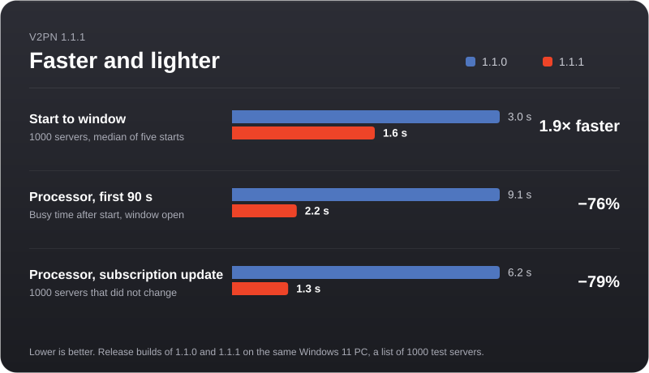
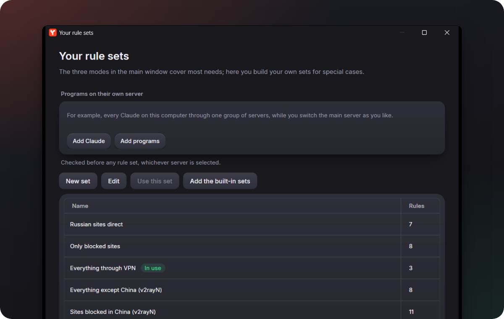
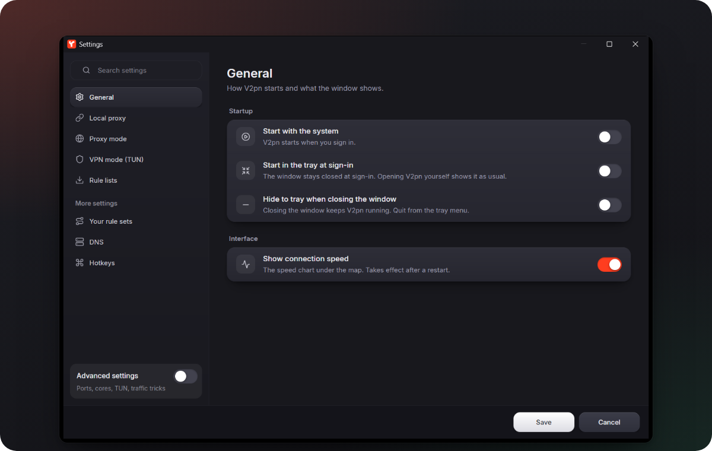
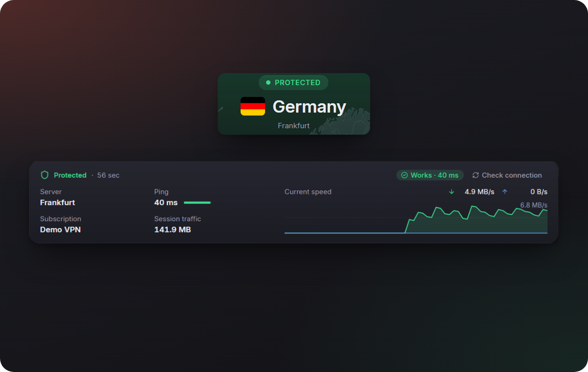

# What's new in V2pn

What changes for the people who use the app. Each version's section becomes the text of its release page on GitHub; the section of the coming version is called "Unreleased" until `tools/release.ps1` is run with its number (rename the heading to that number first).

## 1.2.2

V2pn no longer changes its look for any provider. A provider gets its own build of V2pn instead.

### Plain V2pn stays plain

- V2pn keeps its own look whatever server you pick, a partner provider's included: no provider's colour, logo, card or background.
- A provider's subscription is an ordinary subscription here. Its name, traffic, term, announcement, support and cabinet links, and the Happ, INCY and v2RayTun headers work as for any provider; sign-in by code, provider buttons, hidden servers and closed settings do not.
- V2pn no longer downloads anything about providers, and removes the provider files 1.2.1 kept.
- 1.2.1 and older stop wearing a provider's look at their next check.

### A provider's own build

- A provider's build is the same V2pn with the provider's look always on, sign-in by code with that provider, and its buttons and server descriptions. It comes from the provider's download page (`V2pn-<provider>-windows-x64.zip` and the others, or one command with `V2PN_PARTNER=<provider>`).
- It installs beside V2pn, in its own folder (`V2pn-<provider>`) with its own settings and its own start with the system, so both can be on one computer.
- It updates itself from the same release as V2pn and stays the provider's build after every update.

## 1.2.1

A provider's look is now one look that follows the server you pick, a partner provider can sign you in with a code from its Telegram bot, and the server list gets a Home tab with the fastest server on top and statistics you can turn on.

### A provider's look, simpler

A provider's look is now one look, Accent, and it follows the server you pick: while one of the provider's servers is selected, V2pn wears its brand; pick another server and plain V2pn is back. Neon, the Pass, the look switcher (the title bar, the tray, Ctrl+1…9, the Appearance page), the circle reveal and the intro are gone.

- Accent keeps V2pn's own window: the provider's logo beside V2pn's in the title bar, Connect in its colour, its subscription card in the sidebar with your plan, the days left, devices, traffic, its offer and "Renew" and "Support" links, and its buttons under the connect panel.
- When the provider has a background, the look becomes Scene: the background takes the world map's place, and your plan stands on it. Text on it always reads, in light and dark.
- What says whether you are protected keeps V2pn's own colours, whatever the provider's.

### Partners come from V2pn

V2pn's owner now keeps every partner's look in V2pn's repository and publishes it with V2pn's releases, signed with V2pn's partner key. A provider no longer needs keys, certificates or its own hosting; it sends its logos and colours to the owner.

- A subscription belongs to a partner when its address is on the partner's domains. The provider's site no longer has to send anything for it.
- V2pn checks the list of partners when it starts and every few hours, and downloads a partner's look only when you have its subscription. Everything is checked before use; anything that does not check out is not used, and the last good look stays.
- A partner taken off the list, or whose term ends, loses its look at your next check, with a note. Your servers work as before either way.
- The theme builder is gone. A provider now puts its look together on a web page beside the provider guide ("Build your look"): it sees V2pn's window wear it, in Accent and Scene, light and dark, at every window size, with the same notes the owner's check gives, and downloads the files to send.
- A partner can send its people to a download page of its own: its logo and colours, V2pn for Windows and macOS (the visitor's system first), and the three steps to get its subscription into V2pn. Configra's is the first.

### Sign in with your provider

- A partner provider can let you sign in by code instead of copying a link: "I have a subscription from a provider" in the first-start walkthrough, or "Sign in with a provider" in the + menu. V2pn shows a QR code and six digits; you confirm in the provider's Telegram bot, and V2pn adds your subscription, updates it and selects its first server. Configra is the first.

### The server list: a home tab, list order and statistics

- The first tab is now **Home**. On top, **Fastest server**: if the last ping test is older than half an hour, a click first retests the servers that were quickest, your favorites and recent ones (seconds, not the minute a big subscription takes), and then connects to the winner. The row says when it will retest.
- **Favorites** show the first five; "Show all favorites" opens the rest. Below them: **Recent**, the five **fastest** servers right now, and **Statistics**.
- **Statistics** are off until you turn them on, and stay on this computer. They count the time spent on each server, the connections and how often each server answers ping tests and connection checks. "All statistics" shows connected time per day for two weeks, the servers you use most, the servers that answer most often, and your countries. They can be cleared or turned off there.
- With statistics on, "Fastest server" passes over a server that failed most of its tests, even when its last answer was quick.
- **List order.** The Countries header has a button to sort countries by name, by ping or by use; server lists (a subscription, search results) have the same choice, by ping by default; until you pick one, a subscription keeps its own order (the one you set for it, else the provider's, else fastest first). Servers that didn't answer now sit below the untested ones instead of mixed with them.

## 1.1.1

A release about speed. On Windows V2pn opens twice as fast and stays quiet after it starts; everywhere it updates big subscriptions in a fraction of the time. Nothing in the window changes, and your servers, settings and look stay as they are.

### Opens twice as fast on Windows

With a thousand servers the window now appears after about 1.6 s instead of 3. The Windows app comes precompiled, so the interface no longer has to be compiled every time it starts, and the log, the server table and the Clash pages are built the first time you open them instead of at every start.

### Quiet after it starts

On Windows, V2pn used to look through your Downloads, Desktop, Documents, Program Files and home folder for other VPN apps every time it started, even when you had moved your servers long ago. On a computer with many folders that took up to ten seconds of processor time in the background. Now it looks only when it can offer you something: on the first-run card, in the walkthrough and in "Move from another app". The search itself is about five times faster and finds the same apps.

In the first minute and a half after start, V2pn now keeps the processor busy for 2.2 s instead of 9.1 s.

### Big subscriptions update faster

Updating a subscription wrote every server that stayed in it to disk on its own: two thousand writes for a thousand servers. It is one write now, and an update takes about a fifth of the processor time it did. Every server keeps its ping, star and place in "Recent", as before.

### Smaller things

- Testing the ping of all servers no longer makes the window stop responding for a moment while the test starts.
- With V2pn switched off, update checks no longer wait five seconds for a proxy that isn't running before they go direct.
- V2pn uses 15–30 MB less memory. On Windows, Chinese, Japanese and Korean server names are drawn with Windows' own fonts instead of a 10 MB font V2pn loaded at every start.

### The price

On Windows the app is about 12 MB larger: precompiled code takes more room. The update V2pn downloads by itself is 76 MB instead of 64, the full x64 download 157 MB instead of 144.

## 1.1.0

### Provider looks

A provider can now dress V2pn in its own look. The first is Configra.

- A provider's site or bot can open V2pn with a `v2pn://add` link, on Windows and on macOS. V2pn always asks before adding the subscription, and says when the provider is a confirmed V2pn partner. A link to a subscription you already have only says so. Happ, v2RayTun and Hiddify add links work the same way.
- When the provider is a V2pn partner, V2pn checks its signature and offers its look once: open it or stay in plain V2pn. Switch any time from the name in the title bar, the tray menu, Ctrl+1…9 or the Appearance page; the new look opens as a circle from where you clicked. The connection, settings and servers stay as they are.
- V2pn draws two looks in the provider's colours. Neon is one column like a VPN app on a phone: the provider at the top with Proxy or VPN, one big round Connect button in a glowing ring of its colours (or a row with the server and a switch), the server, the state and what goes through the VPN under it, and at the bottom one sheet: your plan and the days left, the traffic, the provider's offer, then one list with its buttons first and its servers after. It is made for the mini window and opens there the first time when the provider asks; a wider window puts the card beside the column. The Pass is plain V2pn with the provider's card over the status card, like a bank card in Wallet: its logo, your plan and devices, the days left in big type, the traffic, and links to renew and to its cabinet. Configra gets the same two looks.
- Both looks fit every window size, down to the mini window, in light and dark, and have every control: the server list, Proxy or VPN, what goes through the VPN, ping, update and "+". Text in a look always reads well, whatever colours or picture the provider picks.
- On the Appearance page you pick the look, and for Neon light or dark and the provider's colour or one of V2pn's. Neon starts dark; dialogs, menus and settings follow it, and every text in it is checked to read well. The Pass keeps your appearance of plain V2pn; what you set for Neon stays with Neon.
- The look starts with the provider's servers and shows its subscription: traffic, the term, its note, its cabinet and support, and, when the provider shares them, your plan, devices and how many of its servers work by its own checks. When you are connected through another provider's server, the look says so and offers the provider's fastest one.
- A partner's subscription shows its mark in the list, and the subscription window says whether its look is confirmed and until when.
- A provider's look goes away with its last subscription, when the provider stops offering it, when its confirmation runs out or when V2pn withdraws it; V2pn says why and opens plain V2pn.
- The provider does not see your traffic, gets nothing about your device, and cannot change what the connection state says.

### What your provider sets for its subscription

Many providers already set up their subscriptions for Happ, INCY and v2RayTun. V2pn now understands the same settings, so they work in V2pn without any change on the provider's side.

- A provider's banner shows under its subscription in the list, above its servers and in the subscription window: a short note in green, blue or red (V2pn's own colours) with a button such as "Buy" or "More".
- When a subscription ends within three days, or has ended, the banner reminds you instead, with a "Renew" button that leads to the provider's renewal page or its site. The provider can word the reminder itself or turn it off.
- An announcement with a link gets a "More" button.
- A provider can ask V2pn to connect when it starts: to the last server you used, the fastest one or a random one. This happens only when V2pn starts switched off; if you left it connected, it connects as before. A message says where it connected and why. In the subscription window, "Connect at start" → "I'll choose myself" turns it off for that subscription.
- A provider can set the order of its servers (fastest first, by name, or as it sends them), and ask V2pn to update the subscription and test its servers when it starts. The subscription window shows what the provider asked for, and "Server order" lets you pick your own.
- A provider whose V2pn partner certificate covers a new address can move its subscription there; the log says so. Other subscriptions can't move themselves: otherwise anyone answering on the old address could take the subscription away.
- Links from these settings open only if they are https or Telegram.
- When downloading a subscription, V2pn now adds its own name after v2rayN's in the User-Agent, so a provider can answer V2pn with its own settings.

### Your provider's buttons and servers

A V2pn partner can now describe its servers and add a few buttons of its own. What each button does is V2pn's: the provider only names it.

- Up to four buttons such as "Fastest", "Most stable", "For YouTube" or "Renew" sit under Connect while you use one of the provider's servers, and in every look of the provider, at every window size. A connect button tests the servers first and then says where it connected and why: "Germany 2: the fastest", "Netherlands: by Kestrel's check".
- "Most stable" remembers V2pn's last ten checks of each server and takes the one that answered most often and most evenly. "For YouTube" asks the provider which server suits YouTube now and falls back to the fastest suitable one when the provider does not answer.
- Other buttons open the provider's cabinet, renewal page, support or a page on its site, update the subscription, show a short note from the provider, or check whether YouTube, Telegram and ChatGPT open through the connection.
- The provider's servers come in its groups, with their city, what they are for (YouTube, games, mobile internet, whitelists and so on) and a short note. A server the provider hides is not listed.
- The subscription window says what the provider may do: its look, plan details, its own buttons, closed settings.

### Closed settings

A provider that V2pn has checked by hand can close the settings of its subscription, as in Happ and INCY, to keep its servers from being copied.

- The servers' addresses are hidden, and they cannot be edited, shared, copied as links, shown as QR codes, exported or put into a backup. The subscription's link cannot be changed, and the provider can hide it too.
- You can always connect, pick any of its servers, delete the subscription, go back to plain V2pn and use your own servers and routing.
- The subscription says "Settings closed by <provider>", so it never looks like V2pn broke. From any other subscription these settings do nothing.

### Your provider's routes and connection settings

A provider can now offer its own routes and tune how V2pn connects to its servers. V2pn uses each of these only after reading the exact file by hand; if the provider changes it later, V2pn stops using it until it is checked again.

- "What goes through the VPN" gets one more mode, "<provider> routes", while you use one of its servers: for example YouTube, Telegram and AI through the VPN, banks direct. V2pn tells you once that the mode is there; it never switches to it by itself. Your local network always stays direct.
- The provider's fragmentation (and noise on mKCP and Hysteria servers) is used for its servers only, in place of your own fragment setting for them. Your other connections don't change.
- A provider can add its own relay or extra servers, balance between them and send some sites to them, for its servers only. All of it passes the same filter as configs from subscriptions: nothing listens on your network, writes files or reaches your computer from outside.
- The subscription window lists what V2pn checked and whether each part is used, turned off by you, or changed after the check and not used. "<provider> connection settings" turns the fragmentation and the extra servers off for that subscription.
- When the provider's subscription is deleted or its confirmation ends, its routes go too, and V2pn switches to "Everything through VPN" if they were on.

### For providers: the theme builder

With developer mode on (About → updates), the ☰ menu has "Theme builder". A provider puts its theme together there without writing JSON, before it has a certificate.

- A short form: name and id, one to three colours, the two looks as small pictures (a click picks the one the pack opens in), Neon's Connect button and window, the Pass card's background (the brand colour, a gradient or a picture), the pictures and the buttons. A picture that does not fit its place is refused at once, and the place says why.
- On the right, the real look draws it on made-up data: Neon, or the Pass card when the pack opens in the Pass, mini, medium or wide, light or dark, with what V2pn changed so text reads and what it leaves out.
- It opens and saves a pack folder, signs it with the provider's key the same way `tools/partner.cs pack` does, and writes the certificate request. The key can be made there too.
- An older pack opens too: the builder lists the fields V2pn no longer uses and leaves them out when it saves.
- "Show in V2pn" dresses the running app in the unsigned theme. The title bar marks it "Preview" and takes it away; nothing of it is kept, and it is gone after a restart.
- A long state in a look's pill now ends in "…" instead of being cut off.

### First start

A new install now walks you through the setup in five steps: the language (English or Russian), your servers, what goes through the VPN, Proxy or VPN mode, and a summary with a Connect button. Each step can be changed later in the same place on the main screen, and "Skip" is always there.

- The language can be picked right away. A new install no longer has to start in English and be switched in Appearance.
- The servers step shows the download as it goes: how many servers have arrived, and when they are ready.
- The summary shows which server Connect will use, and every choice has a "Change" link.

### Moving from other apps

On the first start V2pn looks for other VPN apps on the computer and offers to bring their subscriptions and servers over: Clash Verge, Clash Party (Mihomo Party), Clash Nyanpasu, Clash for Windows, FlClash, NekoRay and NekoBox, Throne, Hiddify, v2RayTun, Karing, GUI.for.Clash and GUI.for.SingBox, and v2rayN as before. With several apps found, the card lists them with ticks; one button moves all that are ticked.

- Subscriptions come over with the names you gave them and download right away. Servers you added by hand come over as they are.
- The other apps are only read: they keep working as they did.
- A server V2pn already has, or a subscription it already has, is not added twice.
- Kinds of servers V2pn cannot run (plain HTTP proxies, shadow-tls, h2) stay behind, and the message says how many.
- Routing rules of other apps don't come over; V2pn's own modes cover what they are usually for.
- The same is in the menu any time: Tools → "Move from another app". A portable copy the search missed (NekoRay or Throne unpacked somewhere unusual) is found with "Choose the app's folder…".
- Happ keeps its servers encrypted, so V2pn can't read them. The menu shows Happ with a hint: copy the subscription link in Happ and paste it into V2pn.
- A subscription that answers only in Clash format now becomes a list of servers, each on the map, instead of one opaque Clash profile.

### Interface

- The "What goes through the VPN" menu is redone. It has the same dark surface as the bar it opens from instead of a light grey one. Each mode has its own icon, and a radio button shows which one is on. The ad blocker and your own rules line up under the modes, and "Routing settings" became a link at the bottom. The modes on the first-run card look the same.
- Other pop-up panels (pickers in the server window, the theme and backup menus) use the same dark surface too.

### Safety

- Some subscriptions send a whole Xray, sing-box or Clash config instead of server links. Such a config could open your computer to the local network as a proxy, write files to your disk, read your files or let the server connect back to you. V2pn now runs it only after taking all of that out: the servers and the routing to them stay, and its local ports listen on this computer only. The log says what was taken out. Configs you import from your own files run as before.
- A whole config for a core other than Xray, sing-box and Clash is no longer run from a subscription; V2pn says so and suggests asking the provider for server links.

## 1.0.3

### Fixes

- The ⋮ button of a subscription opens its menu again. A click in its middle used to land on the hidden arrow under it and open the subscription instead. The lower edge of the update and + buttons above the subscriptions answers clicks again too.
- A subscription whose site doesn't open directly is fetched through the running VPN. Until now a new subscription, ↻ and "Update all" went direct only, so a blocked or slow provider site sometimes ended in "update failed", while the scheduled updates went through the VPN and worked.
- A new subscription is no longer fetched twice at once (on adding, and by the twice-a-day schedule in the same minute), so the two downloads can't mix up its server list.

## 1.0.2

### A window of any size

The main window can now be made as small as 360 px wide, and its layout follows the width by itself:

- **Wide** (from about 1000 px): as before, the server list beside the map, the tiles on the right and the statistics at the bottom.
- **Medium:** the tiles step aside (Update subscriptions and Settings stay in the ☰ menu), and the statistics card drops the speed graph so its numbers keep their whole text.
- **Narrow, a mini window** (below about 800 px): one column. On top are the protection state, the server, Connect, the mode and the route, with the route on its own line; under them is the server list. Make the window short and the list goes away too, leaving only the state and Connect.

The button next to the window controls (arrows in, arrows out) switches between the mini window and the last full size in one click; it is also in the ☰ menu. V2pn reopens at the size it was left at. Updates, backup and the QR code are wider than the mini window, so the full window opens for them and the mini one comes back when they close.

### Server groups and chains, redone

- The group and chain window is one page instead of three tabs of tables. The servers you add are rows with their flag, name and ping, and each row has its own **up**, **down** and **remove** buttons; the order used to hide behind a right click. A chain numbers its servers and says which way traffic goes: your computer connects to the top one, sites see the bottom one.
- A group can still take every server of a subscription; the window now says how many that is. A new group starts with "Don't take" chosen, so a group with no servers at all can't be saved.
- **Choosing servers** looks like the main list: flags, readable names, the ping, the subscription. Tick boxes instead of Ctrl-clicks, the ticks survive a search or a switch to another subscription, the search works as you type, and servers already in the group (and the group itself) aren't offered. Picking one server for a routing rule or for programs on their own server works the same way, without the boxes; a double click chooses at once.

### Also in this version

- The install commands show what they do: which version comes from where and goes into which folder, a download bar with the speed and the time left, the SHA-256 check against the release, and what was installed. If something goes wrong, they say what and that nothing was installed.

## 1.0.1

### Programs on their own server

In the **Your rule sets** window you can name programs and sites that always go through one server or one group of servers, whatever server is turned on and whatever rule set is in use. **Add Claude** fills in the Claude app, Claude Code and Claude's sites; you only pick a group or create one right there. If the server or the group is gone, V2pn warns you and the programs follow the usual rules.

### Settings in one place

- The **Settings** tile on the map opens the Settings window, the same as Settings in the ☰ menu. Routing rules, DNS and hotkeys open from **More settings** at the bottom of that window.
- Backup, moving from v2rayN, the data folder and the system tools moved to the ☰ menu → **Tools**.
- <kbd>Ctrl</kbd>+<kbd>,</kbd> (<kbd>⌘</kbd>+<kbd>,</kbd> on a Mac) opens Settings.
- The Settings page called "Updates" is now **Rule lists**: it only ever held the site lists for routing. V2pn itself updates from the ☰ menu.

### Install in one command, move from v2rayN in one click

- **Windows:** `irm https://github.com/Piwqust/V2pn/releases/latest/download/install.ps1 | iex`. Installs V2pn without administrator rights, adds shortcuts and moves your data from v2rayN.
- **Mac:** `curl -fsSL https://github.com/Piwqust/V2pn/releases/latest/download/install.sh | bash`. Puts V2pn into Applications without the "unverified developer" warning and moves your data from v2rayN too.
- **Moving from v2rayN:** if v2rayN with servers is on the computer, V2pn offers at its first start to take over the servers, subscriptions, routing and settings. Later it is in the ☰ menu → **Tools** → **Move from v2rayN…**. v2rayN is closed and no longer starts with Windows; its files are left as they are.
- A V2pn installed with winget updates through winget: **Update with winget** in the Updates window.

### The real speed

The speed and the session traffic under the map were about a thousand times too small: the cores report kilobytes, and V2pn showed them as bytes, so 3 MB/s read as 3 KB/s. Now the numbers are right.

### Also in this version

- English is the language of a new install on every system; the others are one click away in Appearance.
- The tray menu opens next to its icon. Before, it could hang in the middle of the screen, high above the taskbar.
- **Your rule sets:** the set in use is marked "In use", and there are **Edit** and **Use this set** buttons. Before, a set could only be changed by double-clicking it.
- When the server does not answer, the card under the map keeps the **Find a working server** button without repeating "No response" next to it: the pill at the top already says so.
- The tile **Update** is now **Update subscriptions**, so it is not mistaken for updating the app.
- In a short window the server's pin on the map no longer hides under the mode switch.
- In the dark theme, windows over the main one (Appearance, backup, QR code) clearly dim what is behind them.
- **Subscriptions:** the "Update with all" column says Yes or No instead of showing a check box that could not be clicked.
- A new server's **Port** field is empty with 443 as a hint, instead of a "0" that had to be deleted first.
- Labels in the sidebar and in Settings are no longer cut off, and the hints are shorter.
- The log starts with V2pn's version, not the number of the v2rayN it is built on.
- If V2pn closed without a word, the log at the next start says when that happened and what Windows recorded around it: a crash, a shutdown, an update of the program it was started from. It helps when you report a problem.
- Screen readers name the DNS fields, the log buttons, the Settings search and the Advanced settings switch.
- Developer mode in the Updates window: V2pn builds itself from source on this computer and installs the build over itself, with a rollback if it does not start. **Back to the release** puts the published version back.
- Long messages in the Updates window wrap instead of going under the buttons.

## 1.0.0

The first public version. Built on v2rayN 7.25.6.

### Connecting

- "Connected" appears after a successful connection check. While starting, it says "Connecting…" and "Checking connection…".
- If the core stops on its own, V2pn restarts it with growing pauses. After five failures in a row it disconnects and leaves the reason on the screen.
- The system proxy is turned on only while the core runs. On exit, shutdown and a crash V2pn removes its own proxy and leaves anybody else's alone.
- If another program holds the port, V2pn does not start on top of it and says so.
- Proxy and VPN modes switch with one button. For VPN on Windows the app asks first, then restarts with administrator rights.

### Servers and subscriptions

- The list on the left: favorites, recent servers, "Fastest server", countries and subscriptions. Servers are on the map too.
- Series like "AUTO 1/34" take one row with the number of servers that answer. The lightning button tests the series again and connects to the fastest.
- Updating a subscription keeps favorites, recent servers and ping results.
- A subscription's row shows the traffic used and the end date when the provider reports them.
- A new subscription updates itself every 12 hours.

### Routing

- Three sets made for Russia: "Russian sites direct", "Only blocked sites", "Everything through VPN". V2pn downloads the site lists they need by itself.
- A "Block ads and trackers" switch.

### Updates

- V2pn checks for new versions itself, downloads them in the background and installs them at the next start.
- Releases are signed. A changed or incomplete package is not installed.
- If the new version does not start, the previous one comes back.

### Appearance

- Light and dark themes, palettes, accent colour, corner shape.
- A simple mode by default. The routing editor, DNS, the server table and the Clash pages are behind the "Advanced settings" switch.
- The interface in English and Russian.

### Systems

- Windows 10 and 11: x64 and ARM64.
- macOS 13.6 or later: Apple silicon and Intel. The macOS build is new.
