# What's new in V2pn

What changes for the people who use the app. Each version's section becomes the text of its release page on GitHub; the section of the coming version is called "Unreleased" until `tools/release.ps1` is run with its number (rename the heading to that number first).

## Unreleased

V2pn moves to a working server by itself when the one you use stops answering, and lets you send chosen sites one way whatever the route says. It is safer by default: VPN mode keeps IPv6 inside the tunnel, the cores' control API needs a secret, updates and installs check signatures everywhere, and a provider's tab on the hub can no longer pose as another provider. Subscriptions from panels with a device limit work, and several quiet failures now either recover or say what happened.

### A working server by itself

- When the server stops answering two checks in a row, V2pn moves to the quickest working server of the same country and says so: "Frankfurt stopped answering. V2pn switched to Berlin in the same country." Another country is never chosen without asking, and two such switches are at least 10 minutes apart. Settings → General → "Switch to a working server by itself" turns it off.
- A connection that works is checked again every 5 minutes, quietly: nothing changes on screen unless the check fails, so a server that dies in the middle of a session no longer stays "connected".

### V2pn from the command line and from AI assistants

- **`v2pnctl`** comes with V2pn: `status`, `servers`, `subs`, `use`, `connect`, `disconnect`, `mode`, `route`, `check`, `diag`, `open`, all with `--json`. If V2pn is not running, it starts in the tray first.
- **`v2pnctl mcp`** is an MCP server for Claude Code, Claude Desktop, Cursor and the like (`claude mcp add v2pn -- v2pnctl mcp`): the assistant can see the status and the servers and switch the server, the mode or the route.
- It is off until you turn it on in Settings → General → "Control from the command line and AI", as read only or with control. It talks only to programs of your own Windows user, over a local channel, never over the network; it never shows subscription links, server addresses or keys.
- A change can be made to undo itself: with `--confirm-within 60` (always, for an assistant) V2pn puts the server, the mode, the route or the connection back unless `v2pnctl confirm` comes in time, so an assistant that cut its own network off gets it back. VPN mode never restarts V2pn as administrator without asking on screen, and every command shows a short note in the window.
- **v2pnctl speaks Russian** on a Russian system: help, mistakes in the command line, the status, the server and subscription tables, and V2pn's answers to it. `V2PN_LANG=en` forces English; the MCP server and `--json` stay English.
- On a Mac it is built but not yet tried.

### Sites that always go one way

- In the menu under Connect, **Sites that always go one way…** sends a site directly or through the server whatever the chosen way says: your bank directly while everything else goes through the server, or one site through the server in "Only blocked". With or without its subdomains; Cyrillic names work too. A change applies at once, and removing a site puts it back under the route.
- **Programs that always go directly…**, the row under it, does the same for programs in VPN mode: a bank's app, a game or a work program goes past the server whatever the route and the sites say. Add one that is running now (from a list with icons, without system processes) or choose its file (an .exe on Windows, an app on a Mac). In Proxy mode programs decide for themselves whether to use the proxy, so the list changes nothing there, and the window says so. Like the sites, it works with V2pn's three ways, not with your own rule sets. On a Mac with "Legacy TUN protection" turned off, Xray runs the tunnel and may not tell programs apart; the window says so too.

### Safety

- **IPv6 stays in the tunnel in VPN mode.** On a network with IPv6 (many mobile and some home providers) the sing-box tunnel, the default one, now takes IPv6 too, as Xray's already did. Before, IPv6 went past the VPN on a Mac and was cut off on Windows.
- **The cores' control API has a secret.** Any program on the computer could switch the core to "direct" with one request (all traffic then went past the server, and the kill switch let it out) or read which sites every program visits. Now the API answers only V2pn, with a new secret on every start.
- **Updates come from the newest signed release of any source**, not from the first that answers, so a source stuck on an old release cannot hold V2pn back. The updater also checks the package against the signed manifest itself, right before it installs, holding it so that nothing can swap it in between.
- **The install commands check the signature** of the release before using it (`install.ps1` on Windows PowerShell 5.1 and 7, `install.sh` with the Mac's own openssl), also from a mirror. The commands on the site and on providers' pages lead straight to GitHub.
- **Cores from the Updates window are checked.** A new Xray, sing-box or mihomo must match the SHA-256 GitHub keeps for that release file before it replaces the one in use. A download cut short or changed on the way is thrown away; before, it became the program that carries all traffic. When GitHub's API does not answer, the core is taken as before and the log says so.
- **The rule lists of the Russian ways get through a blocked GitHub.** runetfreedom's geoip.dat and geosite.dat are checked against the SHA-256 their publisher gives. When the release does not come, or comes changed, they are taken from the release branch on raw.githubusercontent.com, from V2pn's own copy on its server or from jsDelivr, directly or through the connection, and only with a hash the publisher gave. Before, a blocked GitHub left these ways on old lists or none.
- **A provider's tab can no longer be taken over on the hub.** A domain belongs to the provider V2pn signed itself; a tab made on the hub on that domain is left out. A tab's cabinet and support links stay on the provider's own domains or Telegram, and a tab from the hub lasts 60 days after the hub last signed it (the hub signs every day).
- **The log no longer keeps subscription links or tokens**: a subscription that did not parse is logged as its length and a short hash, an address as its host. A subscription larger than 32 MB, or a Clash config that would grow without end, is not read.
- **VPN mode on a Mac writes no scripts for sudo**: the administrator password no longer goes through a file in V2pn's folder.
- The PAC script is served on 127.0.0.1 only. Signing in with a provider no longer sends a computer name someone chose (a Mac is usually named after its owner). A `v2pn://` link to a plain http subscription says the address is not encrypted.
- Kill switch: "Programs only through V2pn" says what it does not close (Windows' own DNS lookups; Claude Code from npm runs as node.exe).
- A whole core config that came with a subscription stays filtered after you move it to another group or to "no group"; before, moving it let it run with its own listeners and API.

### Subscriptions with a device limit

- V2pn sends the device headers panels such as Remnawave count devices by (`x-hwid` and the system and model), as Happ and INCY do. Before, a panel with the device limit on gave V2pn nothing.
- When the plan's device limit is reached, the subscription says so and where to free a slot. The device id is derived from the computer under a V2pn-only salt, so a reinstall takes no new slot.

### Fixes

- A core reload asked for while another runs is no longer lost (a subscription updated in the background could leave the core on old keys).
- The header no longer goes back to the previous server when two refreshes cross.
- Global hotkeys go through Connect and Disconnect: no system proxy over the tunnel in VPN mode, and "clear" disconnects there too.
- Settings are saved even when the window changes them at that moment.
- Two `v2pn://` links clicked quickly both reach V2pn; a link that comes while V2pn asks about another waits its turn.
- "Fastest server" no longer picks from a ping run that was stopped half way, and compares only results from the same half hour: a server whose quick answer came hours ago, maybe on another network, no longer wins over the ones just tested. A server that answered fewer than half of its last checks is passed over with statistics off too.
- An update on a Mac no longer fails for good when a core file is gone right after unpacking: the installed core is kept instead.
- An error nothing else caught is said on screen instead of only in the log.
- Diagnostics: "Report on GitHub…" opens a bug report with the diagnostics already in it; nothing is sent until you submit it.
- Updates → "Tell V2pn when an update fails" (off unless you turn it on): only which version failed to replace which, the system and the step, once per version and step. Nothing about you, your servers or your settings.

### Also

- V2pn takes in v2rayN 8.0.1: raw transport with an HTTP header works with Xray again, and the server form says when the chosen core cannot carry a transport (sing-box with XDRIVE, kcp or xhttp) instead of saving a server that will not connect.

## 1.4.2

V2pn feels at home on a Mac: menus of its own in the menu bar, an icon there that tells the state by its shape, Mac keys, a Dock menu and notifications. On every system it is quieter when nothing happens and opens sooner, and buttons are drawn whole again.

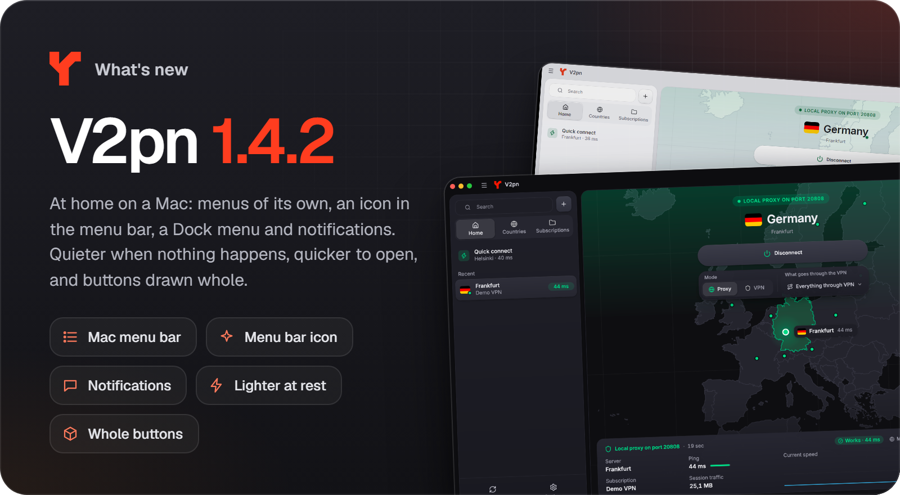

### V2pn on a Mac

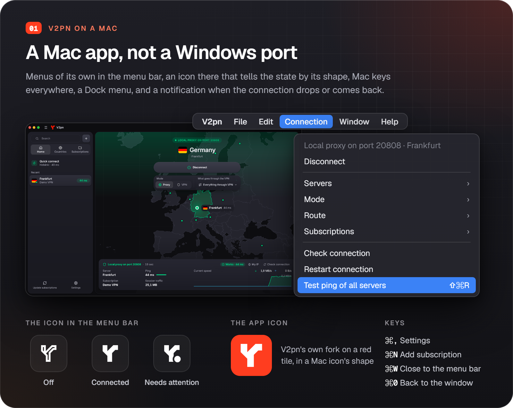

V2pn now behaves like a Mac app, not like a Windows app that also runs on a Mac.

- **Menu bar.** V2pn has menus of its own: the app menu with About V2pn, Settings… (⌘,) and Check for Updates…, then File, Edit, Connection, Window and Help. Connection holds what the window does: connect or disconnect, the servers by country with your favourites and the ones used last, the mode, the route and the subscriptions. Before, the menu bar had "About Avalonia" and Quit, in English whatever the language.
- **The icon in the menu bar** is a one-colour picture that macOS paints to suit a light or a dark bar. The state is told by its shape: an outline when V2pn is off, solid when connected, solid with a dot when the connection needs attention. Its menu has the same submenus: servers, mode, route, subscriptions.
- **About V2pn** is the system's About panel: the version, the versions of the installed cores (Xray, sing-box), and links to the website, the guides, the source and the licence.
- **Keys.** ⌘ wherever Windows has Ctrl, and the menus show ⌘. ⌘W closes the window and V2pn stays in the menu bar, ⌘Q quits, ⌘N adds a subscription, ⌘M minimizes, and ⌘0 goes from the settings or an editor back to the main window. The Edit menu copies, pastes and undoes in every field.
- **The app icon** is V2pn's own: the white fork on a red tile, in the shape and size of a Mac icon. Until now the Mac build carried an older picture.
- **Dock menu**: connect or disconnect, and the servers used last.
- **Notifications** when the connection is lost, or comes back after a loss, while V2pn is not the app in front.
- **Start with the system**: System Settings → Login Items lists the entry as V2pn, not as "sh". An entry made by an earlier version is rewritten the next time V2pn starts. Only the installed app writes it.
- **Settings**: "Hide to the tray on close" is gone on a Mac, where closing the window always leaves V2pn in the menu bar; the other rows say "menu bar", not "tray". The Kill switch page says what it covers on a Mac: proxy mode. Holding the internet closed in VPN mode is still Windows only.

### Lighter and quicker

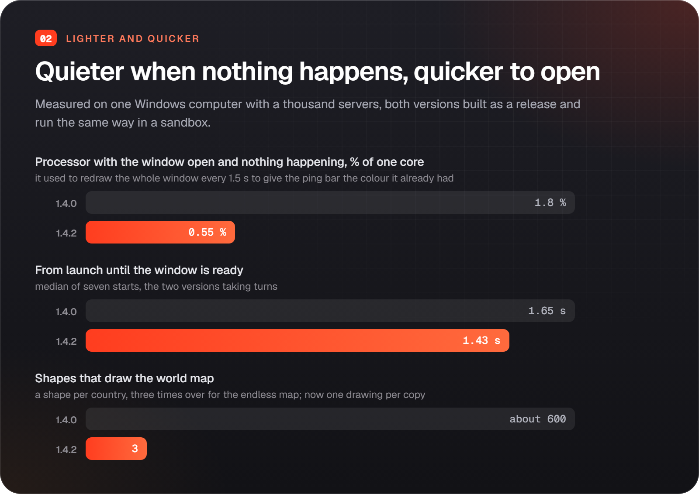

- **Quieter when nothing happens.** With the window open and V2pn idle, it used to redraw the whole window every second and a half to give the ping bar the colour it already had. It now uses less than a third of the processor time it did: 0.55 % of a core instead of 1.8 % on our test computer.
- **Animations run only while you can see them.** A busy spinner hidden in the walkthrough kept V2pn waking 60 times a second, minimized too, and the map's waves would have done the same after a connection change while V2pn sat in the tray.
- **Opens about 0.2 s sooner** with a thousand servers: the world map is three drawings instead of 600 separate shapes, and finding the city in a server's name no longer builds a large search table at start. The map looks exactly as before.
- While the window is minimized and V2pn is connected, the speed graph no longer redraws every second; it catches up when you open the window.

### Looks

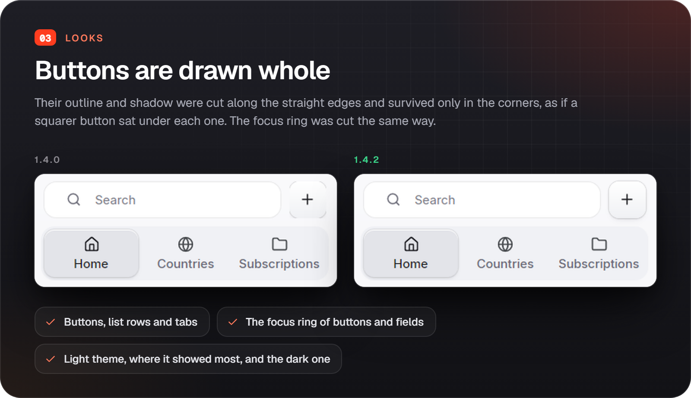

- **Buttons no longer look like two buttons.** The outline and the shadow of buttons, list rows and tabs were cut off along their straight edges and showed only in the corners, as if a squarer button sat under each one; the focus ring of a button or a field was cut the same way. They are whole now, in the light theme, where it showed most, and in the dark one.
- **On a Mac the close, minimize and zoom buttons sit in the middle of V2pn's title bar**, on one line with the menu button and the name, and stay there when the window is resized or its title changes. In full screen the menu button moves to the edge.
- The "Countries" header keeps its whole title and the count: the sort button beside the ping button is its icon alone, with the order in its tooltip. Before, the title was cut in the middle of a letter.
- In the rule sets window "Add a program" moves to a second line instead of being cut off.
- On a Mac, shortcuts in the window's menus are written the Mac way (⇧⌘R, not ⇧+⌘+R); the Appearance page says "System" and "System font" instead of naming Windows and Segoe UI, and shows which theme mode is chosen before one has been saved; "Motion: as in the system" follows Accessibility → Reduce motion.

## 1.4.0

V2pn can now hold the internet closed when the connection drops, and keep the programs you choose, such as Claude, from ever going out past it. It tells you what Russian filtering blocks on your network and tries ways around it. Windows gets an installer of its own, the map zooms to the country and pins the city, and the windows V2pn took over from v2rayN (rule sets, subscriptions, connections, proxies, the log and the settings) now look and read like the rest of V2pn.

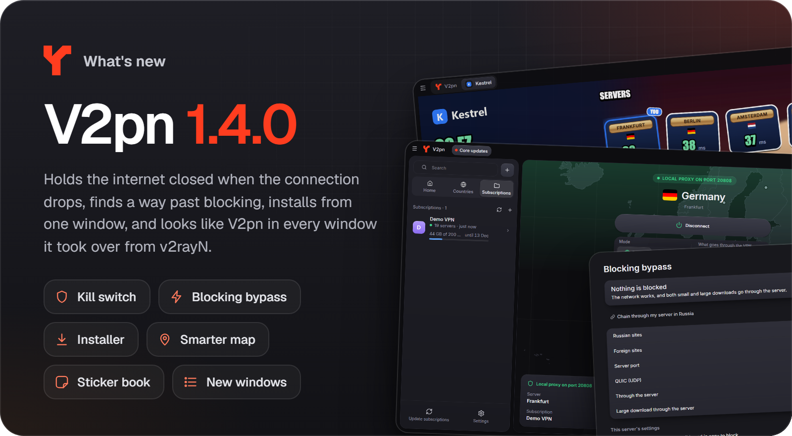

### Kill switch

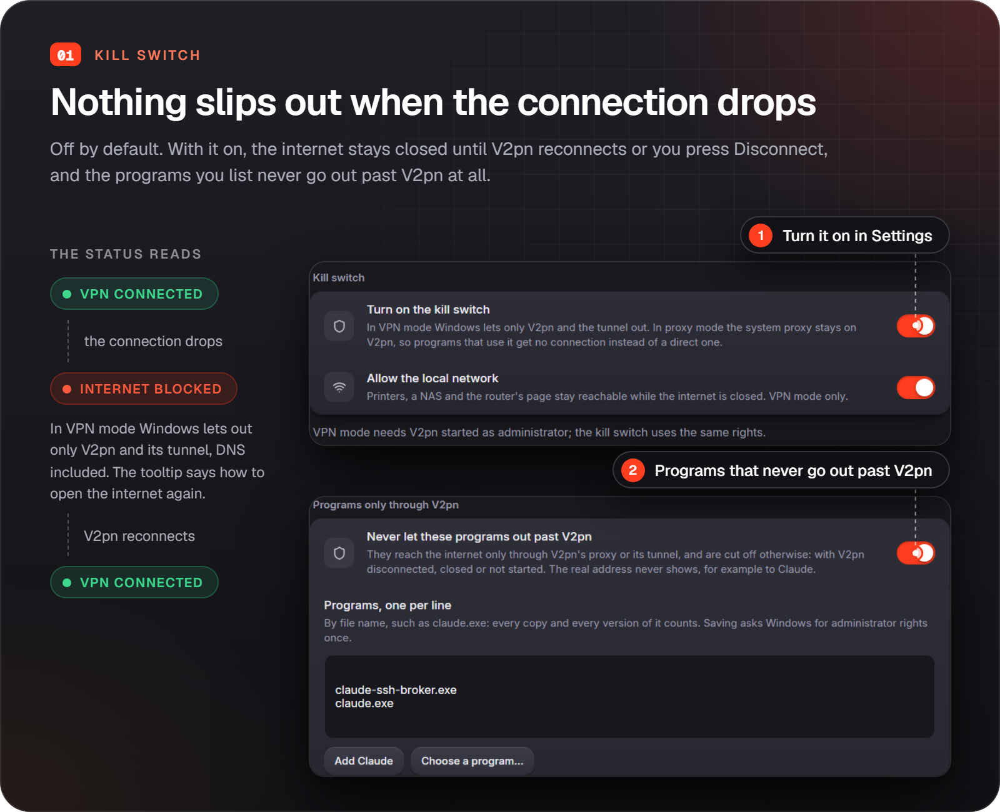

Settings → Kill switch. Off by default; while it is off, a connection that cannot be brought back switches V2pn off and the internet goes on directly, as before.

- With it on, a dropped connection keeps the internet closed until V2pn reconnects or you press Disconnect, so nothing goes out past the VPN. The status reads "Internet blocked", and its tooltip says how to open the internet again.
- In VPN mode Windows itself lets out only V2pn, its cores and the tunnel, from the moment you connect, so nothing slips out while the tunnel comes up or the core restarts either. DNS outside the tunnel is blocked; the local network (printers, the router's page) can stay open. The block is lifted the moment V2pn exits, even if it crashes, so it never leaves a computer without internet behind it.
- In proxy mode the system proxy stays on V2pn with no connection behind it: programs that use the system proxy get nothing instead of a direct connection. Programs that ignore the system proxy are covered only by VPN mode.
- **Programs only through V2pn.** On the same page, list programs (or press "Add Claude") that must never go out past V2pn. They reach the internet only through V2pn's proxy or its tunnel and are cut off at all other times: with V2pn disconnected, closed or not started, so Claude never sees your real address. Programs are matched by file name, so every copy and every version counts. Saving asks Windows for administrator rights once; removing V2pn takes the block away again. Claude Code ignores the system proxy, so in proxy mode it needs HTTPS_PROXY set to V2pn's port; VPN mode needs nothing.

### Blocking bypass

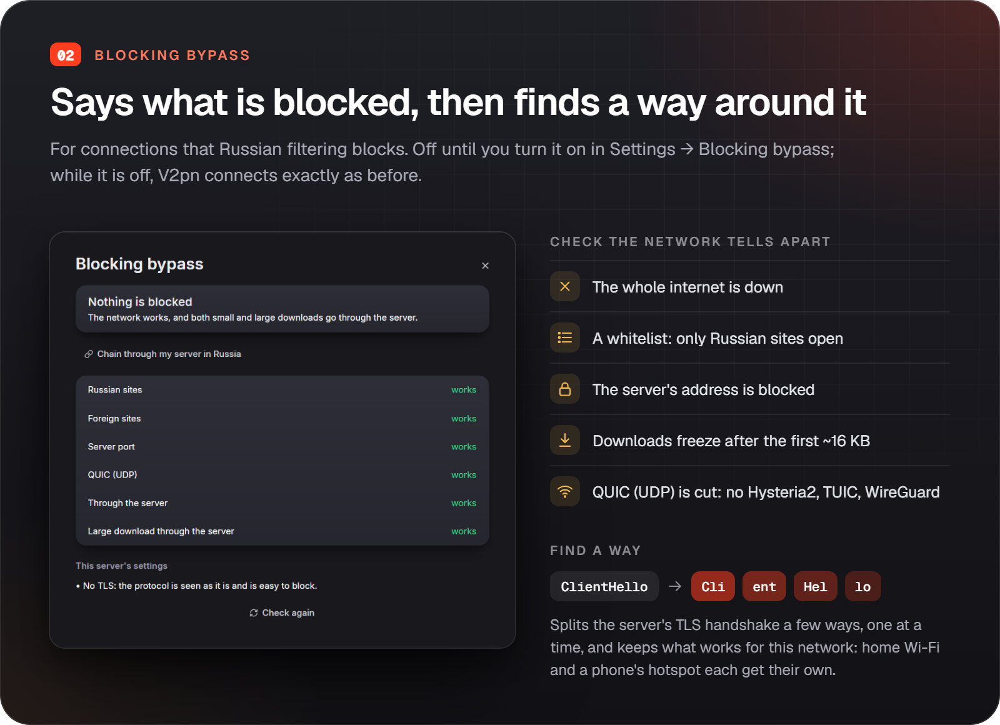

For connections that Russian filtering blocks. It is off until you turn it on in Settings → Blocking bypass; while it is off, V2pn connects exactly as before.

- **Check the network** (☰ → Blocking bypass, or the button under "Server not responding") says in one sentence what is blocked: the whole internet, a whitelist (only Russian sites open), the server's address, downloads that freeze after the first ~16 KB, or the connection itself. It also says when QUIC (UDP) is cut, so Hysteria2, TUIC and WireGuard servers will not work on that network. In VPN mode only the connection is checked: direct checks would go through the tunnel.
- **Find a way**: V2pn tries splitting the server's TLS handshake in a few ways, one at a time with pauses, and keeps the one that works. A way is kept for the network it was found on, so home Wi-Fi and a phone's hotspot each get their own. With automatic search on, this happens by itself when a server stops answering or a large download stops, but only when the network check points at the connection, not at a whitelist or a dead network.
- **Whitelists**: "Connect via a server in Russia" picks the fastest of your servers entered in Russia (by country, or by names like "🇷🇺 →", "белые списки", "LTE"). "Chain through my server in Russia" joins your own Russian server and the selected one into a chain, saved as a server of its own.
- **This server's settings** names what makes the selected server easy to block: REALITY over plain TCP, the name of a big foreign site, a port other than 443, no TLS, plain WireGuard or Shadowsocks, UDP, ECH.
- **Careful connections** (on by default under the bypass): ping tests go a dozen servers at a time, never two entries of one address together, with longer pauses; the core uses a browser's TLS fingerprint where the link left none, and XHTTP's connection reuse is written out.
- **Split the handshake of direct sites** (off by default): for sites that open past the VPN but are slowed down by the filter.
- Rule lists that fail to download try once more the other way, directly or through the connection.

### An installer for Windows

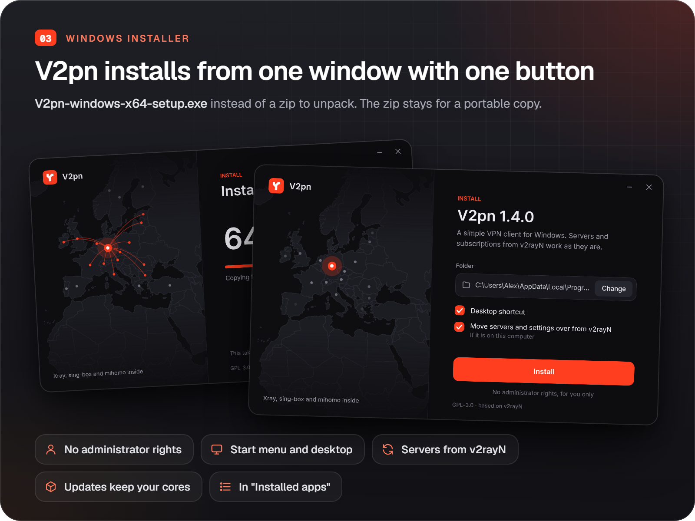

- Windows gets `V2pn-windows-x64-setup.exe` (and `-arm64-setup.exe`) instead of a zip to unpack: a window of V2pn's own, with the map of Europe on the left and one button on the right. It installs V2pn for your Windows user without administrator rights, adds it to the Start menu and, if you leave the box ticked, to the desktop, offers to take your servers from v2rayN, and shows the files going in with lines spreading from the pin on the map.
- If V2pn is running, the window asks you to quit it from the tray, so that the system proxy is put back, and goes on by itself once you have. An update keeps the cores V2pn already has; an older version is installed only if you say so.
- V2pn appears in "Installed apps", with the version it last updated itself to. Removing it opens the same window, which asks whether to keep your servers and settings for the next install.
- Inside is Inno Setup doing the work, hidden. The zip stays for a portable copy.

### V2pn's look in every window

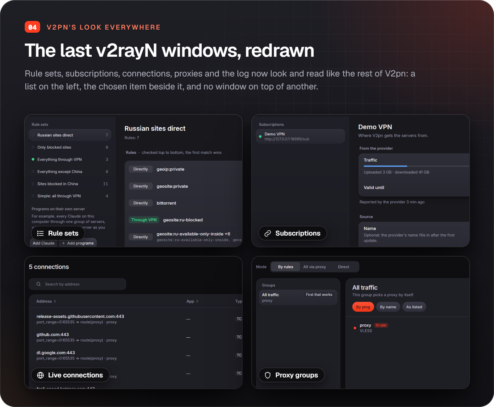

The windows that still came from v2rayN now look and read like the rest of V2pn: a list on the left, the chosen item beside it, and no window opening on top of another.

- **Rule sets**: the sets on the left, with the one in use marked, then the programs on their own server and how sites are matched. The chosen set shows its name to edit in place, "Use this set" or "In use", a menu to duplicate it, copy its rules, import or delete, and its rules as rows: what each does and what it catches, with a menu to move, turn off, copy or delete it. A rule opens below the list with Save and Cancel; everything else is saved at once. The windows for one set and one rule are gone.
- **Subscriptions**: the list on the left (the name, the link or "servers added by hand", a dot when it is included in updates) and the chosen subscription's form beside it. "New subscription" opens an empty form in the same place; Share and Delete sit at the top, and leaving unsaved changes asks first.
- **Connections**: each live connection is a row: the address, the rule and the chain under it, the app, the type and the time, with sorting and a close button on the row. The count, auto refresh and "Close all" sit above the list.
- **Proxies**: the groups in a list beside the chosen group's proxies, a ping pill that tests one, "Use" for groups you pick by hand, the order as chips, and the mode in plain words: by rules, all via proxy, direct.
- **Log**: a field that filters the lines, Copy all and Clear as labelled buttons, and an empty log that says who writes there.
- About eighty rows of Settings, the dialogs, the editors, the tray and the main menu speak V2pn's words instead of v2rayN's, with a short hint where a name says little. Pickers call their empty choice "Not set" instead of showing a blank box, check-box cards became toggle chips, and questions read as a headline with a badge.

### The map

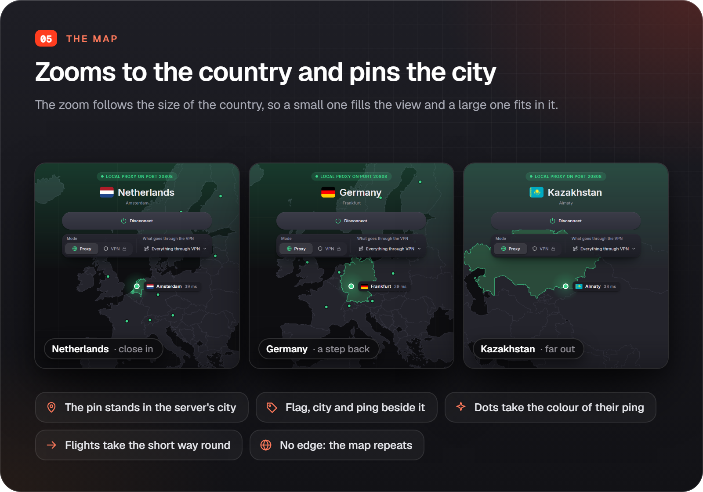

- The zoom follows the size of the country instead of one slice for all: a small country fills the view, a large one fits in it.
- The pin stands in the server's city, taken from its name or the last My IP lookup, with the flag, the city and the ping beside it. "EU" servers get a pin over Europe.
- Server dots take the colour of their best ping; dots that would overlap merge into one with a count.
- The map has no edge: it repeats left and right, and a flight to another server takes the short way round and zooms out in the middle.
- While V2pn is off, the pin no longer sits red on the chosen server: it stands over your own city when a lookup found it, otherwise a quiet ring.

### A calmer Home tab

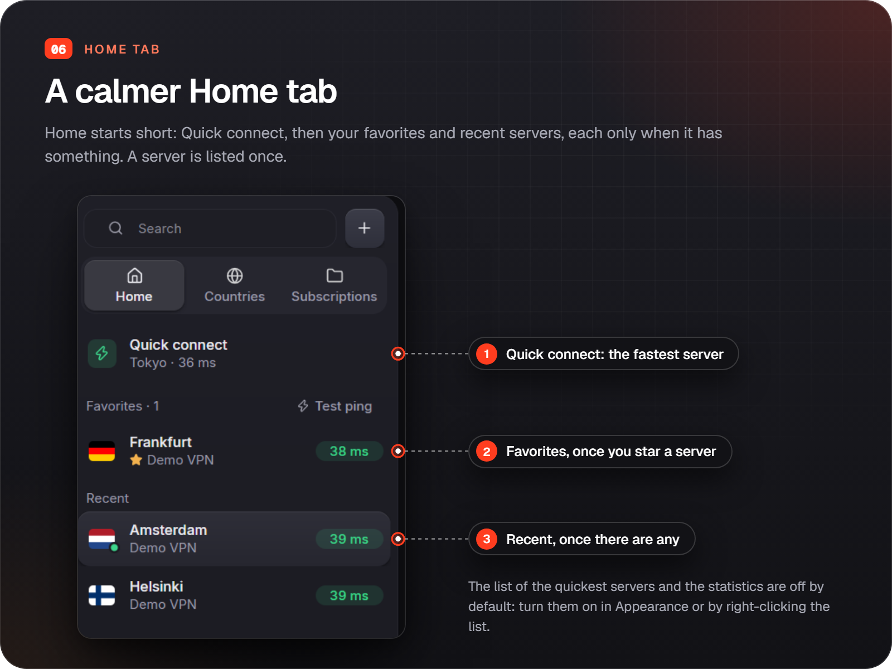

- Home shows "Quick connect" with the fastest server, then your favorites and recent servers, each only when it has something. A server is listed once.
- The list of the quickest servers and the statistics are off by default; turn them on in Appearance or by right-clicking the list. The empty-favorites hint and "Browse countries" are gone: the star next to every server and the Countries tab do the same.

### Partner layouts

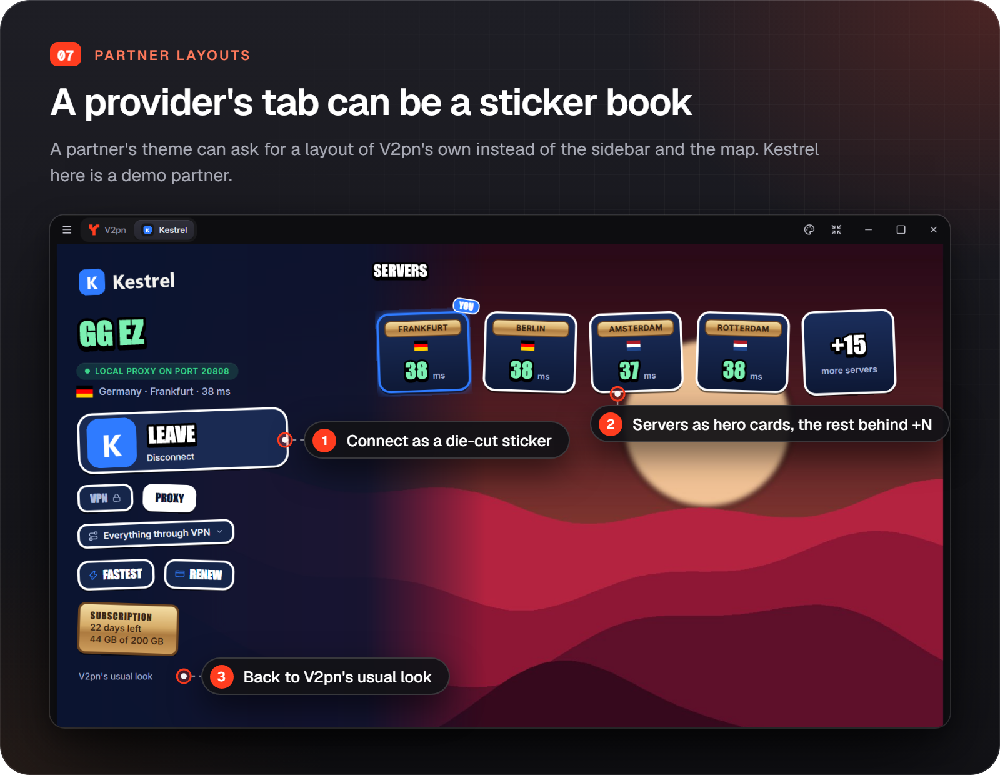

- A partner's theme can ask for a layout of V2pn's own instead of the sidebar and the map. The first is the sticker book: the partner's picture full height, a meme caption over V2pn's usual state, Connect as a die-cut sticker, the partner's buttons as stickers and the servers as hero cards with a brass plate, two rows at most with the rest behind a "+N" card. It is drawn at night whatever the app's theme, and "V2pn's usual look" at its bottom brings the sidebar and the map back for that tab.

### Partners made on the site

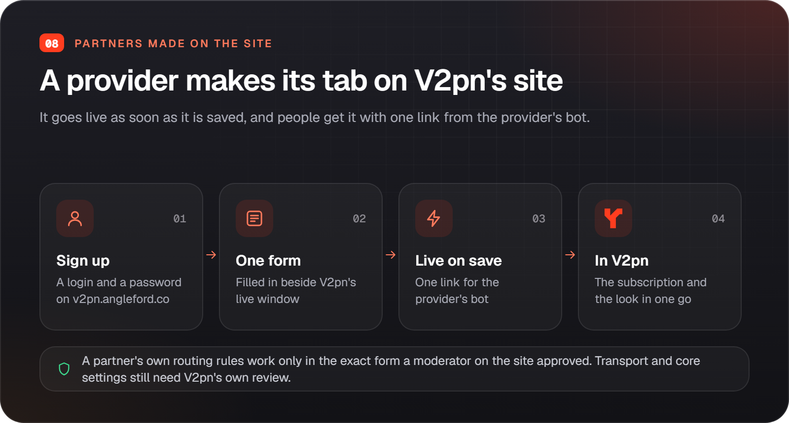

- A provider makes its partner tab on v2pn.angleford.co with a login and a password, and it goes live as soon as it is saved. People get it with one link from the provider's bot: V2pn adds the subscription and the partner's look in one go.
- A partner's own routing rules work once a moderator on the site approves them; V2pn takes them only in the exact form approved. Transport and core settings still need V2pn's own review.

### Also in 1.4.0

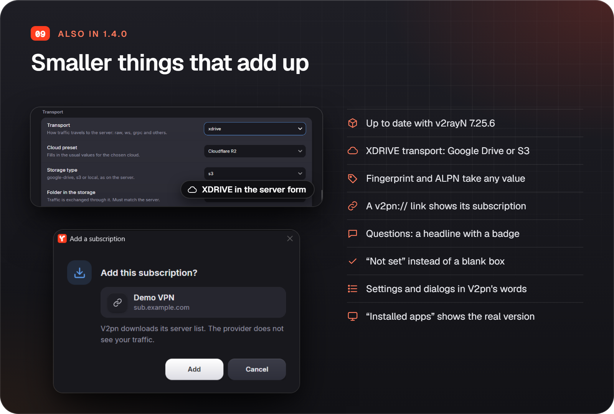

- V2pn takes in v2rayN's latest changes after 7.25.6. The server form gets the XDRIVE transport (traffic through Google Drive or S3 storage) with plain hints and a preset for the usual clouds.
- Fingerprint and ALPN take values outside the list: a link with an ALPN such as "h3,h2" or an unusual fingerprint no longer shows an empty box that saving would write back.
- A v2pn:// link shows the subscription it adds as a card in its question: the name and the address it comes from.
- The line under the country is one short line: the server's name without the country repeated, and the protocol once, only when the name does not already say it. The line "For apps that use the system proxy" under the status is gone; the status's tooltip still says it.

## 1.3.0

V2pn now says "connected" only when it has checked that your connection works, and when something breaks it tells you what and offers the way out: another server, another country, a port, a retry. You can connect right after adding a subscription, a subscription tells you why it didn't update, and a provider you came from gets its own tab in the title bar instead of changing V2pn's look.

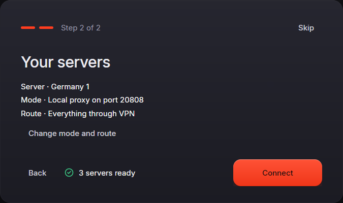

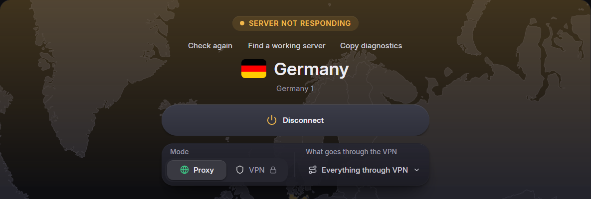

### Tabs in the title bar

V2pn no longer changes its look by the server you pick. If you came to V2pn from a provider that works with it, that provider gets a tab in the title bar. Everyone else sees V2pn as before.

- The title bar has two tabs, as in a browser: **V2pn** and the provider's, with its mark and name. Without a provider there are no tabs.
- The provider's tab shows its colour and background, your plan with the days left, devices and traffic, its buttons, and only its servers. Its sign-in, hidden servers, locked settings, routes and connection settings work only there and only for its subscriptions.
- The V2pn tab is plain V2pn: all your servers, the provider's too, and nothing else from it.
- A click switches tabs at once, and V2pn opens on the tab you left. Ctrl+Tab and Ctrl+Shift+Tab go through them (on a Mac also ⌘⇧] and ⌘⇧[). In the mini window the provider's tab shows only its mark.
- Switching tabs does not touch the connection. A provider's connection settings apply from the next connect. Leaving its tab takes its routing mode out of the menu; if that mode was on, "Everything through VPN" takes its place.

### How you get a provider's tab

- Press the provider's V2pn button in its bot or on its site. It opens the provider's page on v2pn.angleford.co, and "Open in V2pn" there adds the subscription and opens the tab. If you already have that subscription, the tab just opens. Pasting the page's address into V2pn works too.
- Or sign in with the provider by code: "Sign in with a provider" in the + menu, or "I have a subscription from a provider" at first start.
- Pasting a provider's subscription link by hand adds an ordinary subscription, with no tab.
- The tab goes when you delete your last subscription from that provider. If the provider leaves V2pn or its term ends, the tab closes with a note and the V2pn tab opens. Your servers keep working.
- V2pn downloads anything about providers only if you came from one, or while "Sign in with a provider" is open. It deletes the provider files 1.2.1 kept.
- V2pn 1.2.1 and older drop a provider's look at their next check.

### One V2pn for everyone

- There are no separate builds of V2pn for providers any more, and no provider option in the install command. Everyone installs the same V2pn.
- If you installed a provider's build earlier, you keep its tab.
- Providers now apply and design their tab on V2pn's site, v2pn.angleford.co. If the site does not open, V2pn keeps what it already has.

### Updates

- V2pn asks v2pn.angleford.co for updates first, which sends it on to GitHub. If the site does not answer within a few seconds, V2pn goes to GitHub directly. Every update is still checked against V2pn's signature, wherever it comes from.

### "Connected" means checked

- The window, the mini window and the tray say the same thing, and say "connected" only after V2pn has checked the connection you have now: "Proxy connected", "VPN connected" or "Local proxy on port N". In system-proxy mode a line under it says it is for apps that use the system proxy.
- The check goes through the selected server even when your rules would send the check site direct, so a dead server can no longer look alive.
- When the check site doesn't answer, V2pn tries a second site. If that one answers, the connection works; if neither does, it says "Server not responding". HTTP errors, redirects and timeouts each have their own words and "Check again".
- A result for the server you just left no longer lands on the one you picked.

### First connection

- After you add a link or a subscription, the same screen shows how many servers came, the server, the mode and the route, with Connect. "Change mode and route" is there if you want it.
- An empty subscription or a link that isn't one says so right there.

### When a server stops working

- "Find a working server" checks the other servers of the same country first. If none answers, it offers the subscription's other countries, and before switching it tells you the country changes.
- After the computer wakes or the network changes (Wi-Fi to a hotspot, a cable back), V2pn checks the connection again. Your server, mode and route stay, and a connection you switched off stays off.

### Problems with a way out

- When another program holds V2pn's local port, "Change port" opens Settings right at it.
- When VPN mode didn't get administrator rights, you can ask again or connect as a proxy.
- When the reason isn't known, V2pn shows the core's own words and the log instead of guessing.
- "Copy diagnostics" (Help menu, and next to any problem) shows a report for support in full before copying it: versions, system, mode, states and error codes, with no links, keys, server addresses or names.

### Subscriptions

- Each subscription says how its last update ended: the provider's site didn't answer, sent no servers, or sent something that isn't a subscription, and when your saved servers came. They keep working after a failed update. This now also holds for scheduled updates, which looked fresh even when they failed.
- When the provider reports your subscription expired or out of traffic, a note next to Connect says so, with "Update subscription" and the provider's page.
- A provider's site that stops answering ends an update in about a minute and a half instead of four.

### Your own server list

- Update subscriptions, DNS and Settings moved from the map to the foot of the server list.
- Appearance has a section for the list: tabs with icons, names or both, on top or at the bottom; the tab the window opens on; flags and the second line under each server on or off.
- The buttons can sit at the bottom, on top or nowhere, side by side, one under another or as icons, and each of them can be turned off.
- The Home tab is yours to arrange: turn its sections on and off, put them in any order, and pick how many favorites, recent and fastest servers it shows.
- All of it is also right in the list. Right-click the tabs, the buttons, a section's title or an empty spot for its settings. Drag the buttons or the tabs to change their order, or to the other end of the list to move them there; drag a section's title to move the section. "Reset the list" in the same menu puts it all back.

## 1.2.1

A provider's look is now one look that follows the server you pick, a partner provider can sign you in with a code from its Telegram bot, and the server list gets a Home tab with the fastest server on top and statistics you can turn on.

### A provider's look, simpler

A provider's look is now one look, Accent, and it follows the server you pick: while one of the provider's servers is selected, V2pn wears its brand; pick another server and plain V2pn is back. Neon, the Pass, the look switcher (the title bar, the tray, Ctrl+1…9, the Appearance page), the circle reveal and the intro are gone.

- Accent keeps V2pn's own window: the provider's logo beside V2pn's in the title bar, Connect in its colour, its subscription card in the sidebar with your plan, the days left, devices, traffic, its offer and "Renew" and "Support" links, and its buttons under the connect panel.
- When the provider has a background, the look becomes Scene: the background takes the world map's place, and your plan stands on it. Text on it always reads, in light and dark.
- What says whether you are protected keeps V2pn's own colours, whatever the provider's.

### Partners come from V2pn

V2pn's owner now keeps every partner's look in V2pn's repository and publishes it with V2pn's releases, signed with V2pn's partner key. A provider no longer needs keys, certificates or its own hosting; it sends its logos and colours to the owner.

- A subscription belongs to a partner when its address is on the partner's domains. The provider's site no longer has to send anything for it.
- V2pn checks the list of partners when it starts and every few hours, and downloads a partner's look only when you have its subscription. Everything is checked before use; anything that does not check out is not used, and the last good look stays.
- A partner taken off the list, or whose term ends, loses its look at your next check, with a note. Your servers work as before either way.
- The theme builder is gone. A provider now puts its look together on a web page beside the provider guide ("Build your look"): it sees V2pn's window wear it, in Accent and Scene, light and dark, at every window size, with the same notes the owner's check gives, and downloads the files to send.
- A partner can send its people to a download page of its own: its logo and colours, V2pn for Windows and macOS (the visitor's system first), and the three steps to get its subscription into V2pn. Configra's is the first.

### Sign in with your provider

- A partner provider can let you sign in by code instead of copying a link: "I have a subscription from a provider" in the first-start walkthrough, or "Sign in with a provider" in the + menu. V2pn shows a QR code and six digits; you confirm in the provider's Telegram bot, and V2pn adds your subscription, updates it and selects its first server. Configra is the first.

### The server list: a home tab, list order and statistics

- The first tab is now **Home**. On top, **Fastest server**: if the last ping test is older than half an hour, a click first retests the servers that were quickest, your favorites and recent ones (seconds, not the minute a big subscription takes), and then connects to the winner. The row says when it will retest.
- **Favorites** show the first five; "Show all favorites" opens the rest. Below them: **Recent**, the five **fastest** servers right now, and **Statistics**.
- **Statistics** are off until you turn them on, and stay on this computer. They count the time spent on each server, the connections and how often each server answers ping tests and connection checks. "All statistics" shows connected time per day for two weeks, the servers you use most, the servers that answer most often, and your countries. They can be cleared or turned off there.
- With statistics on, "Fastest server" passes over a server that failed most of its tests, even when its last answer was quick.
- **List order.** The Countries header has a button to sort countries by name, by ping or by use; server lists (a subscription, search results) have the same choice, by ping by default; until you pick one, a subscription keeps its own order (the one you set for it, else the provider's, else fastest first). Servers that didn't answer now sit below the untested ones instead of mixed with them.

## 1.1.1

A release about speed. On Windows V2pn opens twice as fast and stays quiet after it starts; everywhere it updates big subscriptions in a fraction of the time. Nothing in the window changes, and your servers, settings and look stay as they are.

### Opens twice as fast on Windows

With a thousand servers the window now appears after about 1.6 s instead of 3. The Windows app comes precompiled, so the interface no longer has to be compiled every time it starts, and the log, the server table and the Clash pages are built the first time you open them instead of at every start.

### Quiet after it starts

On Windows, V2pn used to look through your Downloads, Desktop, Documents, Program Files and home folder for other VPN apps every time it started, even when you had moved your servers long ago. On a computer with many folders that took up to ten seconds of processor time in the background. Now it looks only when it can offer you something: on the first-run card, in the walkthrough and in "Move from another app". The search itself is about five times faster and finds the same apps.

In the first minute and a half after start, V2pn now keeps the processor busy for 2.2 s instead of 9.1 s.

### Big subscriptions update faster

Updating a subscription wrote every server that stayed in it to disk on its own: two thousand writes for a thousand servers. It is one write now, and an update takes about a fifth of the processor time it did. Every server keeps its ping, star and place in "Recent", as before.

### Smaller things

- Testing the ping of all servers no longer makes the window stop responding for a moment while the test starts.
- With V2pn switched off, update checks no longer wait five seconds for a proxy that isn't running before they go direct.
- V2pn uses 15–30 MB less memory. On Windows, Chinese, Japanese and Korean server names are drawn with Windows' own fonts instead of a 10 MB font V2pn loaded at every start.

### The price

On Windows the app is about 12 MB larger: precompiled code takes more room. The update V2pn downloads by itself is 76 MB instead of 64, the full x64 download 157 MB instead of 144.

## 1.1.0

### Provider looks

A provider can now dress V2pn in its own look. The first is Configra.

- A provider's site or bot can open V2pn with a `v2pn://add` link, on Windows and on macOS. V2pn always asks before adding the subscription, and says when the provider is a confirmed V2pn partner. A link to a subscription you already have only says so. Happ, v2RayTun and Hiddify add links work the same way.
- When the provider is a V2pn partner, V2pn checks its signature and offers its look once: open it or stay in plain V2pn. Switch any time from the name in the title bar, the tray menu, Ctrl+1…9 or the Appearance page; the new look opens as a circle from where you clicked. The connection, settings and servers stay as they are.
- V2pn draws two looks in the provider's colours. Neon is one column like a VPN app on a phone: the provider at the top with Proxy or VPN, one big round Connect button in a glowing ring of its colours (or a row with the server and a switch), the server, the state and what goes through the VPN under it, and at the bottom one sheet: your plan and the days left, the traffic, the provider's offer, then one list with its buttons first and its servers after. It is made for the mini window and opens there the first time when the provider asks; a wider window puts the card beside the column. The Pass is plain V2pn with the provider's card over the status card, like a bank card in Wallet: its logo, your plan and devices, the days left in big type, the traffic, and links to renew and to its cabinet. Configra gets the same two looks.
- Both looks fit every window size, down to the mini window, in light and dark, and have every control: the server list, Proxy or VPN, what goes through the VPN, ping, update and "+". Text in a look always reads well, whatever colours or picture the provider picks.
- On the Appearance page you pick the look, and for Neon light or dark and the provider's colour or one of V2pn's. Neon starts dark; dialogs, menus and settings follow it, and every text in it is checked to read well. The Pass keeps your appearance of plain V2pn; what you set for Neon stays with Neon.
- The look starts with the provider's servers and shows its subscription: traffic, the term, its note, its cabinet and support, and, when the provider shares them, your plan, devices and how many of its servers work by its own checks. When you are connected through another provider's server, the look says so and offers the provider's fastest one.
- A partner's subscription shows its mark in the list, and the subscription window says whether its look is confirmed and until when.
- A provider's look goes away with its last subscription, when the provider stops offering it, when its confirmation runs out or when V2pn withdraws it; V2pn says why and opens plain V2pn.
- The provider does not see your traffic, gets nothing about your device, and cannot change what the connection state says.

### What your provider sets for its subscription

Many providers already set up their subscriptions for Happ, INCY and v2RayTun. V2pn now understands the same settings, so they work in V2pn without any change on the provider's side.

- A provider's banner shows under its subscription in the list, above its servers and in the subscription window: a short note in green, blue or red (V2pn's own colours) with a button such as "Buy" or "More".
- When a subscription ends within three days, or has ended, the banner reminds you instead, with a "Renew" button that leads to the provider's renewal page or its site. The provider can word the reminder itself or turn it off.
- An announcement with a link gets a "More" button.
- A provider can ask V2pn to connect when it starts: to the last server you used, the fastest one or a random one. This happens only when V2pn starts switched off; if you left it connected, it connects as before. A message says where it connected and why. In the subscription window, "Connect at start" → "I'll choose myself" turns it off for that subscription.
- A provider can set the order of its servers (fastest first, by name, or as it sends them), and ask V2pn to update the subscription and test its servers when it starts. The subscription window shows what the provider asked for, and "Server order" lets you pick your own.
- A provider whose V2pn partner certificate covers a new address can move its subscription there; the log says so. Other subscriptions can't move themselves: otherwise anyone answering on the old address could take the subscription away.
- Links from these settings open only if they are https or Telegram.
- When downloading a subscription, V2pn now adds its own name after v2rayN's in the User-Agent, so a provider can answer V2pn with its own settings.

### Your provider's buttons and servers

A V2pn partner can now describe its servers and add a few buttons of its own. What each button does is V2pn's: the provider only names it.

- Up to four buttons such as "Fastest", "Most stable", "For YouTube" or "Renew" sit under Connect while you use one of the provider's servers, and in every look of the provider, at every window size. A connect button tests the servers first and then says where it connected and why: "Germany 2: the fastest", "Netherlands: by Kestrel's check".
- "Most stable" remembers V2pn's last ten checks of each server and takes the one that answered most often and most evenly. "For YouTube" asks the provider which server suits YouTube now and falls back to the fastest suitable one when the provider does not answer.
- Other buttons open the provider's cabinet, renewal page, support or a page on its site, update the subscription, show a short note from the provider, or check whether YouTube, Telegram and ChatGPT open through the connection.
- The provider's servers come in its groups, with their city, what they are for (YouTube, games, mobile internet, whitelists and so on) and a short note. A server the provider hides is not listed.
- The subscription window says what the provider may do: its look, plan details, its own buttons, closed settings.

### Closed settings

A provider that V2pn has checked by hand can close the settings of its subscription, as in Happ and INCY, to keep its servers from being copied.

- The servers' addresses are hidden, and they cannot be edited, shared, copied as links, shown as QR codes, exported or put into a backup. The subscription's link cannot be changed, and the provider can hide it too.
- You can always connect, pick any of its servers, delete the subscription, go back to plain V2pn and use your own servers and routing.
- The subscription says "Settings closed by <provider>", so it never looks like V2pn broke. From any other subscription these settings do nothing.

### Your provider's routes and connection settings

A provider can now offer its own routes and tune how V2pn connects to its servers. V2pn uses each of these only after reading the exact file by hand; if the provider changes it later, V2pn stops using it until it is checked again.

- "What goes through the VPN" gets one more mode, "<provider> routes", while you use one of its servers: for example YouTube, Telegram and AI through the VPN, banks direct. V2pn tells you once that the mode is there; it never switches to it by itself. Your local network always stays direct.
- The provider's fragmentation (and noise on mKCP and Hysteria servers) is used for its servers only, in place of your own fragment setting for them. Your other connections don't change.
- A provider can add its own relay or extra servers, balance between them and send some sites to them, for its servers only. All of it passes the same filter as configs from subscriptions: nothing listens on your network, writes files or reaches your computer from outside.
- The subscription window lists what V2pn checked and whether each part is used, turned off by you, or changed after the check and not used. "<provider> connection settings" turns the fragmentation and the extra servers off for that subscription.
- When the provider's subscription is deleted or its confirmation ends, its routes go too, and V2pn switches to "Everything through VPN" if they were on.

### For providers: the theme builder

With developer mode on (About → updates), the ☰ menu has "Theme builder". A provider puts its theme together there without writing JSON, before it has a certificate.

- A short form: name and id, one to three colours, the two looks as small pictures (a click picks the one the pack opens in), Neon's Connect button and window, the Pass card's background (the brand colour, a gradient or a picture), the pictures and the buttons. A picture that does not fit its place is refused at once, and the place says why.
- On the right, the real look draws it on made-up data: Neon, or the Pass card when the pack opens in the Pass, mini, medium or wide, light or dark, with what V2pn changed so text reads and what it leaves out.
- It opens and saves a pack folder, signs it with the provider's key the same way `tools/partner.cs pack` does, and writes the certificate request. The key can be made there too.
- An older pack opens too: the builder lists the fields V2pn no longer uses and leaves them out when it saves.
- "Show in V2pn" dresses the running app in the unsigned theme. The title bar marks it "Preview" and takes it away; nothing of it is kept, and it is gone after a restart.
- A long state in a look's pill now ends in "…" instead of being cut off.

### First start

A new install now walks you through the setup in five steps: the language (English or Russian), your servers, what goes through the VPN, Proxy or VPN mode, and a summary with a Connect button. Each step can be changed later in the same place on the main screen, and "Skip" is always there.

- The language can be picked right away. A new install no longer has to start in English and be switched in Appearance.
- The servers step shows the download as it goes: how many servers have arrived, and when they are ready.
- The summary shows which server Connect will use, and every choice has a "Change" link.

### Moving from other apps

On the first start V2pn looks for other VPN apps on the computer and offers to bring their subscriptions and servers over: Clash Verge, Clash Party (Mihomo Party), Clash Nyanpasu, Clash for Windows, FlClash, NekoRay and NekoBox, Throne, Hiddify, v2RayTun, Karing, GUI.for.Clash and GUI.for.SingBox, and v2rayN as before. With several apps found, the card lists them with ticks; one button moves all that are ticked.

- Subscriptions come over with the names you gave them and download right away. Servers you added by hand come over as they are.
- The other apps are only read: they keep working as they did.
- A server V2pn already has, or a subscription it already has, is not added twice.
- Kinds of servers V2pn cannot run (plain HTTP proxies, shadow-tls, h2) stay behind, and the message says how many.
- Routing rules of other apps don't come over; V2pn's own modes cover what they are usually for.
- The same is in the menu any time: Tools → "Move from another app". A portable copy the search missed (NekoRay or Throne unpacked somewhere unusual) is found with "Choose the app's folder…".
- Happ keeps its servers encrypted, so V2pn can't read them. The menu shows Happ with a hint: copy the subscription link in Happ and paste it into V2pn.
- A subscription that answers only in Clash format now becomes a list of servers, each on the map, instead of one opaque Clash profile.

### Interface

- The "What goes through the VPN" menu is redone. It has the same dark surface as the bar it opens from instead of a light grey one. Each mode has its own icon, and a radio button shows which one is on. The ad blocker and your own rules line up under the modes, and "Routing settings" became a link at the bottom. The modes on the first-run card look the same.
- Other pop-up panels (pickers in the server window, the theme and backup menus) use the same dark surface too.

### Safety

- Some subscriptions send a whole Xray, sing-box or Clash config instead of server links. Such a config could open your computer to the local network as a proxy, write files to your disk, read your files or let the server connect back to you. V2pn now runs it only after taking all of that out: the servers and the routing to them stay, and its local ports listen on this computer only. The log says what was taken out. Configs you import from your own files run as before.
- A whole config for a core other than Xray, sing-box and Clash is no longer run from a subscription; V2pn says so and suggests asking the provider for server links.

## 1.0.3

### Fixes

- The ⋮ button of a subscription opens its menu again. A click in its middle used to land on the hidden arrow under it and open the subscription instead. The lower edge of the update and + buttons above the subscriptions answers clicks again too.
- A subscription whose site doesn't open directly is fetched through the running VPN. Until now a new subscription, ↻ and "Update all" went direct only, so a blocked or slow provider site sometimes ended in "update failed", while the scheduled updates went through the VPN and worked.
- A new subscription is no longer fetched twice at once (on adding, and by the twice-a-day schedule in the same minute), so the two downloads can't mix up its server list.

## 1.0.2

### A window of any size

The main window can now be made as small as 360 px wide, and its layout follows the width by itself:

- **Wide** (from about 1000 px): as before, the server list beside the map, the tiles on the right and the statistics at the bottom.
- **Medium:** the tiles step aside (Update subscriptions and Settings stay in the ☰ menu), and the statistics card drops the speed graph so its numbers keep their whole text.
- **Narrow, a mini window** (below about 800 px): one column. On top are the protection state, the server, Connect, the mode and the route, with the route on its own line; under them is the server list. Make the window short and the list goes away too, leaving only the state and Connect.

The button next to the window controls (arrows in, arrows out) switches between the mini window and the last full size in one click; it is also in the ☰ menu. V2pn reopens at the size it was left at. Updates, backup and the QR code are wider than the mini window, so the full window opens for them and the mini one comes back when they close.

### Server groups and chains, redone

- The group and chain window is one page instead of three tabs of tables. The servers you add are rows with their flag, name and ping, and each row has its own **up**, **down** and **remove** buttons; the order used to hide behind a right click. A chain numbers its servers and says which way traffic goes: your computer connects to the top one, sites see the bottom one.
- A group can still take every server of a subscription; the window now says how many that is. A new group starts with "Don't take" chosen, so a group with no servers at all can't be saved.
- **Choosing servers** looks like the main list: flags, readable names, the ping, the subscription. Tick boxes instead of Ctrl-clicks, the ticks survive a search or a switch to another subscription, the search works as you type, and servers already in the group (and the group itself) aren't offered. Picking one server for a routing rule or for programs on their own server works the same way, without the boxes; a double click chooses at once.

### Also in this version

- The install commands show what they do: which version comes from where and goes into which folder, a download bar with the speed and the time left, the SHA-256 check against the release, and what was installed. If something goes wrong, they say what and that nothing was installed.

## 1.0.1

### Programs on their own server

In the **Your rule sets** window you can name programs and sites that always go through one server or one group of servers, whatever server is turned on and whatever rule set is in use. **Add Claude** fills in the Claude app, Claude Code and Claude's sites; you only pick a group or create one right there. If the server or the group is gone, V2pn warns you and the programs follow the usual rules.

### Settings in one place

- The **Settings** tile on the map opens the Settings window, the same as Settings in the ☰ menu. Routing rules, DNS and hotkeys open from **More settings** at the bottom of that window.
- Backup, moving from v2rayN, the data folder and the system tools moved to the ☰ menu → **Tools**.
- <kbd>Ctrl</kbd>+<kbd>,</kbd> (<kbd>⌘</kbd>+<kbd>,</kbd> on a Mac) opens Settings.
- The Settings page called "Updates" is now **Rule lists**: it only ever held the site lists for routing. V2pn itself updates from the ☰ menu.

### Install in one command, move from v2rayN in one click

- **Windows:** `irm https://github.com/Piwqust/V2pn/releases/latest/download/install.ps1 | iex`. Installs V2pn without administrator rights, adds shortcuts and moves your data from v2rayN.
- **Mac:** `curl -fsSL https://github.com/Piwqust/V2pn/releases/latest/download/install.sh | bash`. Puts V2pn into Applications without the "unverified developer" warning and moves your data from v2rayN too.
- **Moving from v2rayN:** if v2rayN with servers is on the computer, V2pn offers at its first start to take over the servers, subscriptions, routing and settings. Later it is in the ☰ menu → **Tools** → **Move from v2rayN…**. v2rayN is closed and no longer starts with Windows; its files are left as they are.
- A V2pn installed with winget updates through winget: **Update with winget** in the Updates window.

### The real speed

The speed and the session traffic under the map were about a thousand times too small: the cores report kilobytes, and V2pn showed them as bytes, so 3 MB/s read as 3 KB/s. Now the numbers are right.

### Also in this version

- English is the language of a new install on every system; the others are one click away in Appearance.
- The tray menu opens next to its icon. Before, it could hang in the middle of the screen, high above the taskbar.
- **Your rule sets:** the set in use is marked "In use", and there are **Edit** and **Use this set** buttons. Before, a set could only be changed by double-clicking it.
- When the server does not answer, the card under the map keeps the **Find a working server** button without repeating "No response" next to it: the pill at the top already says so.
- The tile **Update** is now **Update subscriptions**, so it is not mistaken for updating the app.
- In a short window the server's pin on the map no longer hides under the mode switch.
- In the dark theme, windows over the main one (Appearance, backup, QR code) clearly dim what is behind them.
- **Subscriptions:** the "Update with all" column says Yes or No instead of showing a check box that could not be clicked.
- A new server's **Port** field is empty with 443 as a hint, instead of a "0" that had to be deleted first.
- Labels in the sidebar and in Settings are no longer cut off, and the hints are shorter.
- The log starts with V2pn's version, not the number of the v2rayN it is built on.
- If V2pn closed without a word, the log at the next start says when that happened and what Windows recorded around it: a crash, a shutdown, an update of the program it was started from. It helps when you report a problem.
- Screen readers name the DNS fields, the log buttons, the Settings search and the Advanced settings switch.
- Developer mode in the Updates window: V2pn builds itself from source on this computer and installs the build over itself, with a rollback if it does not start. **Back to the release** puts the published version back.
- Long messages in the Updates window wrap instead of going under the buttons.

## 1.0.0

The first public version. Built on v2rayN 7.25.6.

### Connecting

- "Connected" appears after a successful connection check. While starting, it says "Connecting…" and "Checking connection…".
- If the core stops on its own, V2pn restarts it with growing pauses. After five failures in a row it disconnects and leaves the reason on the screen.
- The system proxy is turned on only while the core runs. On exit, shutdown and a crash V2pn removes its own proxy and leaves anybody else's alone.
- If another program holds the port, V2pn does not start on top of it and says so.
- Proxy and VPN modes switch with one button. For VPN on Windows the app asks first, then restarts with administrator rights.

### Servers and subscriptions

- The list on the left: favorites, recent servers, "Fastest server", countries and subscriptions. Servers are on the map too.
- Series like "AUTO 1/34" take one row with the number of servers that answer. The lightning button tests the series again and connects to the fastest.
- Updating a subscription keeps favorites, recent servers and ping results.
- A subscription's row shows the traffic used and the end date when the provider reports them.
- A new subscription updates itself every 12 hours.

### Routing

- Three sets made for Russia: "Russian sites direct", "Only blocked sites", "Everything through VPN". V2pn downloads the site lists they need by itself.
- A "Block ads and trackers" switch.

### Updates

- V2pn checks for new versions itself, downloads them in the background and installs them at the next start.
- Releases are signed. A changed or incomplete package is not installed.
- If the new version does not start, the previous one comes back.

### Appearance

- Light and dark themes, palettes, accent colour, corner shape.
- A simple mode by default. The routing editor, DNS, the server table and the Clash pages are behind the "Advanced settings" switch.
- The interface in English and Russian.

### Systems

- Windows 10 and 11: x64 and ARM64.
- macOS 13.6 or later: Apple silicon and Intel. The macOS build is new.
