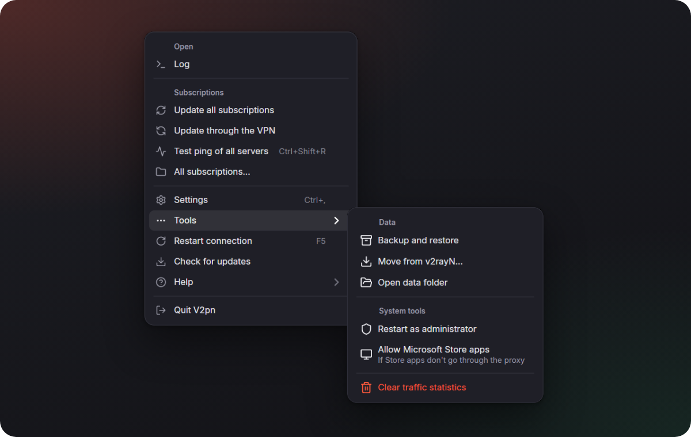

# What's new in V2pn

What changes for the people who use the app. Each version's section becomes the text of its release page on GitHub; the section of the coming version is called "Unreleased" until `tools/release.ps1` is run with its number (rename the heading to that number first).

## Unreleased

### The server list: a home tab, list order and statistics

- The first tab is now **Home**. On top, **Fastest server**: if the last ping test is older than half an hour, a click first retests the servers that were quickest, your favorites and recent ones (seconds, not the minute a big subscription takes), and then connects to the winner. The row says when it will retest.
- **Favorites** show the first five; "Show all favorites" opens the rest. Below them: **Recent**, the five **fastest** servers right now, and **Statistics**.
- **Statistics** are off until you turn them on, and stay on this computer. They count the time spent on each server, the connections and how often each server answers ping tests and connection checks. "All statistics" shows connected time per day for two weeks, the servers you use most, the servers that answer most often, and your countries. They can be cleared or turned off there.
- With statistics on, "Fastest server" passes over a server that failed most of its tests, even when its last answer was quick.
- **List order.** The Countries header has a button to sort countries by name, by ping or by use; server lists (a subscription, search results) have the same choice, by ping by default. Servers that didn't answer now sit below the untested ones instead of mixed with them.

## 1.0.3

### Fixes

- The ⋮ button of a subscription opens its menu again. A click in its middle used to land on the hidden arrow under it and open the subscription instead. The lower edge of the update and + buttons above the subscriptions answers clicks again too.
- A subscription whose site doesn't open directly is fetched through the running VPN. Until now a new subscription, ↻ and "Update all" went direct only, so a blocked or slow provider site sometimes ended in "update failed", while the scheduled updates went through the VPN and worked.
- A new subscription is no longer fetched twice at once (on adding, and by the twice-a-day schedule in the same minute), so the two downloads can't mix up its server list.

## 1.0.2

### A window of any size

The main window can now be made as small as 360 px wide, and its layout follows the width by itself:

- **Wide** (from about 1000 px): as before, the server list beside the map, the tiles on the right and the statistics at the bottom.
- **Medium:** the tiles step aside (Update subscriptions and Settings stay in the ☰ menu), and the statistics card drops the speed graph so its numbers keep their whole text.
- **Narrow, a mini window** (below about 800 px): one column. On top are the protection state, the server, Connect, the mode and the route, with the route on its own line; under them is the server list. Make the window short and the list goes away too, leaving only the state and Connect.

The button next to the window controls (arrows in, arrows out) switches between the mini window and the last full size in one click; it is also in the ☰ menu. V2pn reopens at the size it was left at. Updates, backup and the QR code are wider than the mini window, so the full window opens for them and the mini one comes back when they close.

### Server groups and chains, redone

- The group and chain window is one page instead of three tabs of tables. The servers you add are rows with their flag, name and ping, and each row has its own **up**, **down** and **remove** buttons; the order used to hide behind a right click. A chain numbers its servers and says which way traffic goes: your computer connects to the top one, sites see the bottom one.
- A group can still take every server of a subscription; the window now says how many that is. A new group starts with "Don't take" chosen, so a group with no servers at all can't be saved.
- **Choosing servers** looks like the main list: flags, readable names, the ping, the subscription. Tick boxes instead of Ctrl-clicks, the ticks survive a search or a switch to another subscription, the search works as you type, and servers already in the group (and the group itself) aren't offered. Picking one server for a routing rule or for programs on their own server works the same way, without the boxes; a double click chooses at once.

### Also in this version

- The install commands show what they do: which version comes from where and goes into which folder, a download bar with the speed and the time left, the SHA-256 check against the release, and what was installed. If something goes wrong, they say what and that nothing was installed.

## 1.0.1

### Programs on their own server

In the **Your rule sets** window you can name programs and sites that always go through one server or one group of servers, whatever server is turned on and whatever rule set is in use. **Add Claude** fills in the Claude app, Claude Code and Claude's sites; you only pick a group or create one right there. If the server or the group is gone, V2pn warns you and the programs follow the usual rules.

### Settings in one place

- The **Settings** tile on the map opens the Settings window, the same as Settings in the ☰ menu. Routing rules, DNS and hotkeys open from **More settings** at the bottom of that window.
- Backup, moving from v2rayN, the data folder and the system tools moved to the ☰ menu → **Tools**.
- <kbd>Ctrl</kbd>+<kbd>,</kbd> (<kbd>⌘</kbd>+<kbd>,</kbd> on a Mac) opens Settings.
- The Settings page called "Updates" is now **Rule lists**: it only ever held the site lists for routing. V2pn itself updates from the ☰ menu.

### Install in one command, move from v2rayN in one click

- **Windows:** `irm https://github.com/Piwqust/V2pn/releases/latest/download/install.ps1 | iex`. Installs V2pn without administrator rights, adds shortcuts and moves your data from v2rayN.
- **Mac:** `curl -fsSL https://github.com/Piwqust/V2pn/releases/latest/download/install.sh | bash`. Puts V2pn into Applications without the "unverified developer" warning and moves your data from v2rayN too.
- **Moving from v2rayN:** if v2rayN with servers is on the computer, V2pn offers at its first start to take over the servers, subscriptions, routing and settings. Later it is in the ☰ menu → **Tools** → **Move from v2rayN…**. v2rayN is closed and no longer starts with Windows; its files are left as they are.
- A V2pn installed with winget updates through winget: **Update with winget** in the Updates window.

### The real speed

The speed and the session traffic under the map were about a thousand times too small: the cores report kilobytes, and V2pn showed them as bytes, so 3 MB/s read as 3 KB/s. Now the numbers are right.

### Also in this version

- English is the language of a new install on every system; the others are one click away in Appearance.
- The tray menu opens next to its icon. Before, it could hang in the middle of the screen, high above the taskbar.
- **Your rule sets:** the set in use is marked "In use", and there are **Edit** and **Use this set** buttons. Before, a set could only be changed by double-clicking it.
- When the server does not answer, the card under the map keeps the **Find a working server** button without repeating "No response" next to it: the pill at the top already says so.
- The tile **Update** is now **Update subscriptions**, so it is not mistaken for updating the app.
- In a short window the server's pin on the map no longer hides under the mode switch.
- In the dark theme, windows over the main one (Appearance, backup, QR code) clearly dim what is behind them.
- **Subscriptions:** the "Update with all" column says Yes or No instead of showing a check box that could not be clicked.
- A new server's **Port** field is empty with 443 as a hint, instead of a "0" that had to be deleted first.
- Labels in the sidebar and in Settings are no longer cut off, and the hints are shorter.
- The log starts with V2pn's version, not the number of the v2rayN it is built on.
- If V2pn closed without a word, the log at the next start says when that happened and what Windows recorded around it: a crash, a shutdown, an update of the program it was started from. It helps when you report a problem.
- Screen readers name the DNS fields, the log buttons, the Settings search and the Advanced settings switch.
- Developer mode in the Updates window: V2pn builds itself from source on this computer and installs the build over itself, with a rollback if it does not start. **Back to the release** puts the published version back.
- Long messages in the Updates window wrap instead of going under the buttons.

## 1.0.0

The first public version. Built on v2rayN 7.25.6.

### Connecting

- "Connected" appears after a successful connection check. While starting, it says "Connecting…" and "Checking connection…".
- If the core stops on its own, V2pn restarts it with growing pauses. After five failures in a row it disconnects and leaves the reason on the screen.
- The system proxy is turned on only while the core runs. On exit, shutdown and a crash V2pn removes its own proxy and leaves anybody else's alone.
- If another program holds the port, V2pn does not start on top of it and says so.
- Proxy and VPN modes switch with one button. For VPN on Windows the app asks first, then restarts with administrator rights.

### Servers and subscriptions

- The list on the left: favorites, recent servers, "Fastest server", countries and subscriptions. Servers are on the map too.
- Series like "AUTO 1/34" take one row with the number of servers that answer. The lightning button tests the series again and connects to the fastest.
- Updating a subscription keeps favorites, recent servers and ping results.
- A subscription's row shows the traffic used and the end date when the provider reports them.
- A new subscription updates itself every 12 hours.

### Routing

- Three sets made for Russia: "Russian sites direct", "Only blocked sites", "Everything through VPN". V2pn downloads the site lists they need by itself.
- A "Block ads and trackers" switch.

### Updates

- V2pn checks for new versions itself, downloads them in the background and installs them at the next start.
- Releases are signed. A changed or incomplete package is not installed.
- If the new version does not start, the previous one comes back.

### Appearance

- Light and dark themes, palettes, accent colour, corner shape.
- A simple mode by default. The routing editor, DNS, the server table and the Clash pages are behind the "Advanced settings" switch.
- The interface in English and Russian.

### Systems

- Windows 10 and 11: x64 and ARM64.
- macOS 13.6 or later: Apple silicon and Intel. The macOS build is new.
