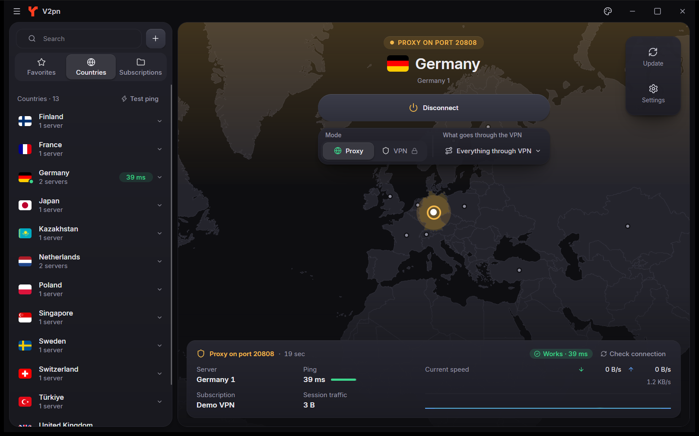
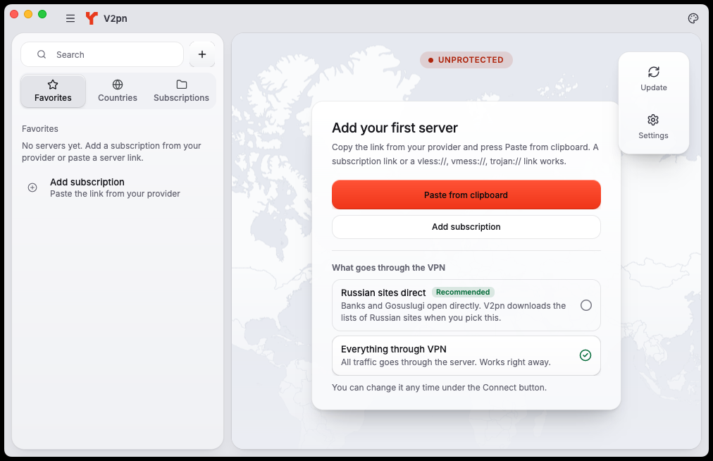

# V2pn

[](https://github.com/Piwqust/V2pn/releases/latest)
[](LICENSE)
[](https://github.com/Piwqust/V2pn/actions/workflows/v2pn-ci.yml)

A VPN client for Windows and macOS with a simple interface. It runs [v2rayN](https://github.com/2dust/v2rayN) with the Xray, sing-box and mihomo cores inside, so the same servers and subscriptions work: VLESS, VMess, Trojan, Shadowsocks, Hysteria2, TUIC, WireGuard.

[Русский](README.md)

<p align="center"></p>

## Download

| System | File |
| --- | --- |
| Windows 10 and 11, x64 | [V2pn-windows-x64.zip](https://github.com/Piwqust/V2pn/releases/latest/download/V2pn-windows-x64.zip) |
| Windows 11, ARM64 | [V2pn-windows-arm64.zip](https://github.com/Piwqust/V2pn/releases/latest/download/V2pn-windows-arm64.zip) |
| macOS 13.6 or later, Apple silicon | [V2pn-macos-arm64.dmg](https://github.com/Piwqust/V2pn/releases/latest/download/V2pn-macos-arm64.dmg) |
| macOS 13.6 or later, Intel | [V2pn-macos-x64.dmg](https://github.com/Piwqust/V2pn/releases/latest/download/V2pn-macos-x64.dmg) |

There is no Linux build.

All versions: [Releases](https://github.com/Piwqust/V2pn/releases). Changes: [CHANGELOG.md](CHANGELOG.md) (in Russian).

### Windows

1. Unpack the archive into a folder you can write to, for example `C:\Users\<you>\V2pn`. Not `Program Files`: settings and servers are kept next to the program.
2. Run `V2pn.exe`.
3. Windows may show the blue "Windows protected your PC" window, because the app has no paid developer signature. Press "More info", then "Run anyway".

.NET does not need to be installed; it is inside.

### macOS

1. Open the `.dmg` and drag V2pn to Applications.
2. Start V2pn. macOS will say it cannot verify the developer: the app is not signed with a paid Apple certificate.
3. Open System Settings → Privacy & Security, scroll down and press "Open Anyway" next to V2pn. This is needed once.

If there is no "Open Anyway", run this in Terminal:

```bash
xattr -cr /Applications/V2pn.app
```

On a Mac, settings and servers live in `~/Library/Application Support/V2pn`.

<p align="center"></p>

The macOS build is new: an automated check builds it and starts it on a Mac, but few people have used it on real machines yet. If something does not work, [open an issue](https://github.com/Piwqust/V2pn/issues/new/choose).

## Getting started

1. Copy the subscription link from your VPN provider (or a server link such as `vless://…`).
2. In V2pn press "Paste from clipboard".
3. Pick a server in the list or on the map and press "Connect".

Two choices sit under the button:

- **Proxy or VPN.** Proxy turns on the system proxy: browsers and programs that use it go through the server. VPN routes all traffic of the computer, games included; it needs administrator rights on Windows and your password on macOS.
- **What goes through the server.** Three presets made for Russia: Russian sites direct, blocked sites only, or everything through the VPN.

## How V2pn differs from v2rayN

- **The status tells the truth.** "Connected" appears after a successful connection check, not after the button is pressed. If the core dies, V2pn restarts it; after five failures in a row it disconnects and says why.
- **The internet does not disappear after exit.** The system proxy is set only while the core runs and is cleared on exit, shutdown and a crash. A proxy set by another program is left alone.
- **Busy port.** If another program holds the port, V2pn does not start on top of it and says so.
- **Subscriptions.** Updating a subscription keeps favourites, recent servers and ping results. Traffic and expiry are shown in the list.
- **Server list.** Servers are grouped by country, numbered series like "AUTO 1/34" collapse into one row, and there are favourites, recents and "Fastest".
- **Routing presets** with one click, no rule editor needed.
- **Updates.** V2pn updates itself; see below.
- **Appearance:** themes, accent colour, corner radius.

Everything v2rayN can do (the routing editor, DNS, custom core configs, backups) is still there behind the "Advanced settings" switch.

## Updates

Every six hours V2pn checks for a new version, downloads it in the background and installs it at the next start or when you press "Restart and update". A running connection is never cut by an update. Automatic installation can be turned off in the Updates window.

- Every release is signed with a key whose public half is built into the app. V2pn will not install a package without that signature, a changed one or an incomplete one, wherever it was downloaded from.
- If the new version does not start, the installer puts the previous one back.
- Settings, servers and cores are not touched by an update.
- Cores (Xray, sing-box, mihomo) and site lists are updated separately in the same window.

What exactly is checked before installing: [docs/V2PN-RELEASES.md](docs/V2PN-RELEASES.md#что-именно-проверяется) (in Russian).

## Building from source

You need the [.NET 10 SDK](https://dot.net).

```bash
git clone --recursive https://github.com/Piwqust/V2pn.git
```

```bash
dotnet build V2pn/v2rayN/v2rayN.Desktop/v2rayN.Desktop.csproj -c Release
```

```bash
dotnet test --project V2pn/v2rayN/ServiceLib.Tests/ServiceLib.Tests.csproj -c Release
```

The sources live in the `v2rayN/` folder: the name is kept from the original so that its updates merge without conflicts. For the same reason the root holds v2rayN's `package-*.sh` scripts; V2pn does not use them.

A build from source shows its version with `-dev` and does not update itself. Release packages are made by `tools/release.ps1` (Windows) and `tools/package-macos.sh` (macOS).

Developer documentation (in Russian):

- [docs/V2PN-UX.md](docs/V2PN-UX.md): how the interface is built and why;
- [docs/V2PN-RELEASES.md](docs/V2PN-RELEASES.md): releases, updates, the mirror, merging v2rayN.

## License and credits

[GPL-3.0](LICENSE), the same as v2rayN. V2pn is a fork of [2dust/v2rayN](https://github.com/2dust/v2rayN): connecting, protocols, subscriptions and core handling are the work of its authors. Cores: [Xray-core](https://github.com/XTLS/Xray-core), [sing-box](https://github.com/SagerNet/sing-box), [mihomo](https://github.com/MetaCubeX/mihomo). Icons: [Lucide](https://lucide.dev).

V2pn does not sell or provide servers. You need your own subscription or server.
