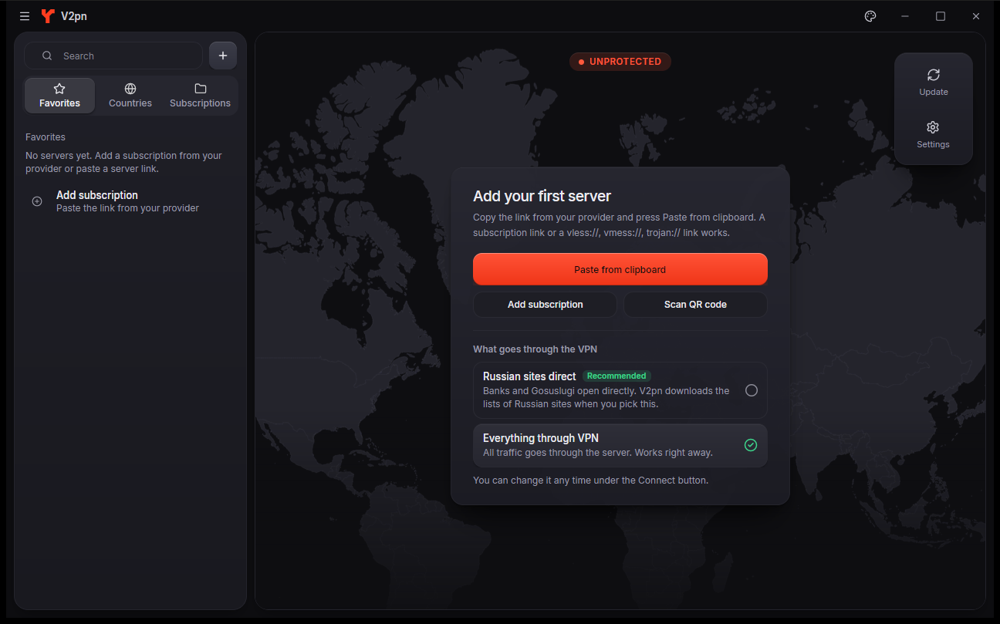

# V2pn

VPN-клиент для Windows и macOS с простым интерфейсом. Внутри работает [v2rayN](https://github.com/2dust/v2rayN) с ядрами Xray, sing-box и mihomo, поэтому подходят те же серверы и подписки: VLESS, VMess, Trojan, Shadowsocks, Hysteria2, TUIC, WireGuard.

[English](README.en.md)



## Скачать

| Система | Файл |
| --- | --- |
| Windows 10 и 11, x64 | [V2pn-windows-x64.zip](https://github.com/Piwqust/V2pn/releases/latest/download/V2pn-windows-x64.zip) |
| Windows 11, ARM64 | [V2pn-windows-arm64.zip](https://github.com/Piwqust/V2pn/releases/latest/download/V2pn-windows-arm64.zip) |
| macOS 13.6 и новее, Apple silicon (M1 и новее) | [V2pn-macos-arm64.dmg](https://github.com/Piwqust/V2pn/releases/latest/download/V2pn-macos-arm64.dmg) |
| macOS 13.6 и новее, Intel | [V2pn-macos-x64.dmg](https://github.com/Piwqust/V2pn/releases/latest/download/V2pn-macos-x64.dmg) |

Все версии и список изменений: [Releases](https://github.com/Piwqust/V2pn/releases), [CHANGELOG.md](CHANGELOG.md).

### Windows

1. Распакуйте архив в любую папку, куда у вас есть право записи, например `C:\Users\<вы>\V2pn`. В `Program Files` не кладите: настройки и серверы хранятся рядом с программой.
2. Запустите `V2pn.exe`.
3. Windows может показать синее окно «Система Windows защитила ваш компьютер»: у приложения нет платной подписи разработчика. Нажмите «Подробнее», затем «Выполнить в любом случае».

Устанавливать .NET не нужно, он внутри.

### macOS

1. Откройте `.dmg` и перетащите V2pn в «Программы».
2. Запустите V2pn. macOS скажет, что не может проверить разработчика: приложение не подписано платным сертификатом Apple.
3. Откройте «Системные настройки» → «Конфиденциальность и безопасность», прокрутите вниз и нажмите «Всё равно открыть» рядом с V2pn. Это нужно один раз.

Если пункта «Всё равно открыть» нет, выполните в Терминале:

```bash
xattr -cr /Applications/V2pn.app
```

Настройки и серверы на Mac лежат в `~/Library/Application Support/V2pn`.

Сборка для macOS новая. Если что-то работает не так, [напишите](https://github.com/Piwqust/V2pn/issues/new/choose).

## Как начать

1. Скопируйте ссылку подписки у своего провайдера VPN (или ссылку сервера вида `vless://…`).
2. В V2pn нажмите «Вставить из буфера».
3. Выберите сервер в списке слева или на карте и нажмите «Подключиться».

Под кнопкой два выбора:

- **Прокси или VPN.** «Прокси» включает системный прокси: через сервер идут браузеры и программы, которые его используют. «VPN» заворачивает весь трафик компьютера, включая игры; на Windows для этого нужны права администратора, на macOS пароль.
- **Что идёт через сервер.** «Российские сайты напрямую», «Только заблокированное» или «Всё через VPN».

## Чем V2pn отличается от v2rayN

- **Статус не обманывает.** «Подключено» появляется после успешной проверки соединения, а не после нажатия кнопки. Если ядро упало, V2pn перезапускает его; если не вышло пять раз подряд, отключается и пишет причину.
- **Интернет не пропадает после выхода.** Системный прокси включается только при работающем ядре и снимается при выходе, выключении компьютера и аварийном завершении. Прокси, который поставила другая программа, V2pn не трогает.
- **Занятый порт.** Если порт держит другая программа, V2pn не запускается поверх неё и говорит об этом.
- **Подписки.** Обновление подписки не сбрасывает избранное, недавние серверы и результаты проверки пинга. Трафик и срок подписки видны в списке.
- **Список серверов.** Серверы сгруппированы по странам, серии вида «AUTO 1/34» свёрнуты в одну строку, есть избранное, недавние и «Самый быстрый».
- **Маршруты для России** одной кнопкой, без редактора правил.
- **Обновления.** V2pn обновляет себя сам, см. ниже.
- **Оформление:** темы, цвет акцента, скругления.

Всё, что умеет v2rayN (редактор маршрутов, DNS, свои конфигурации ядер, резервные копии), осталось и открывается переключателем «Расширенные настройки».

## Обновления

V2pn раз в шесть часов проверяет, вышла ли новая версия, скачивает её в фоне и ставит при следующем запуске или по кнопке «Перезапустить и обновить». Работающее соединение обновление не обрывает. Автоматическую установку можно выключить в окне «Обновления».

- Каждый релиз подписан ключом, открытая часть которого встроена в приложение. Пакет без этой подписи, изменённый или недокачанный, V2pn не установит, откуда бы он ни был скачан.
- Если новая версия не запустилась, установщик возвращает предыдущую.
- Настройки, серверы и ядра обновление не трогает.
- Ядра (Xray, sing-box, mihomo) и списки сайтов обновляются отдельно в том же окне.

Как выпускаются версии и как устроена проверка: [docs/V2PN-RELEASES.md](docs/V2PN-RELEASES.md).

## Сборка из исходников

Нужен [.NET SDK 10](https://dot.net).

```bash
git clone --recursive https://github.com/Piwqust/V2pn.git
```

```bash
dotnet build V2pn/v2rayN/v2rayN.Desktop/v2rayN.Desktop.csproj -c Release
```

```bash
dotnet test --project V2pn/v2rayN/ServiceLib.Tests/ServiceLib.Tests.csproj -c Release
```

Сборка из исходников показывает версию с пометкой `-dev` и сама не обновляется. Пакеты, как в релизе, собирают `tools/release.ps1` (Windows) и `tools/package-macos.sh` (macOS).

Документация для разработчиков:

- [docs/V2PN-UX.md](docs/V2PN-UX.md): как устроен интерфейс и почему;
- [docs/V2PN-RELEASES.md](docs/V2PN-RELEASES.md): релизы, обновления, зеркало, слияние с v2rayN.

## Лицензия и благодарности

[GPL-3.0](LICENSE), как и v2rayN. V2pn — форк [2dust/v2rayN](https://github.com/2dust/v2rayN): подключение, протоколы, подписки и работа с ядрами написаны его авторами. Ядра: [Xray-core](https://github.com/XTLS/Xray-core), [sing-box](https://github.com/SagerNet/sing-box), [mihomo](https://github.com/MetaCubeX/mihomo). Значки: [Lucide](https://lucide.dev).

V2pn не продаёт и не предоставляет серверы. Нужна своя подписка или свой сервер.
