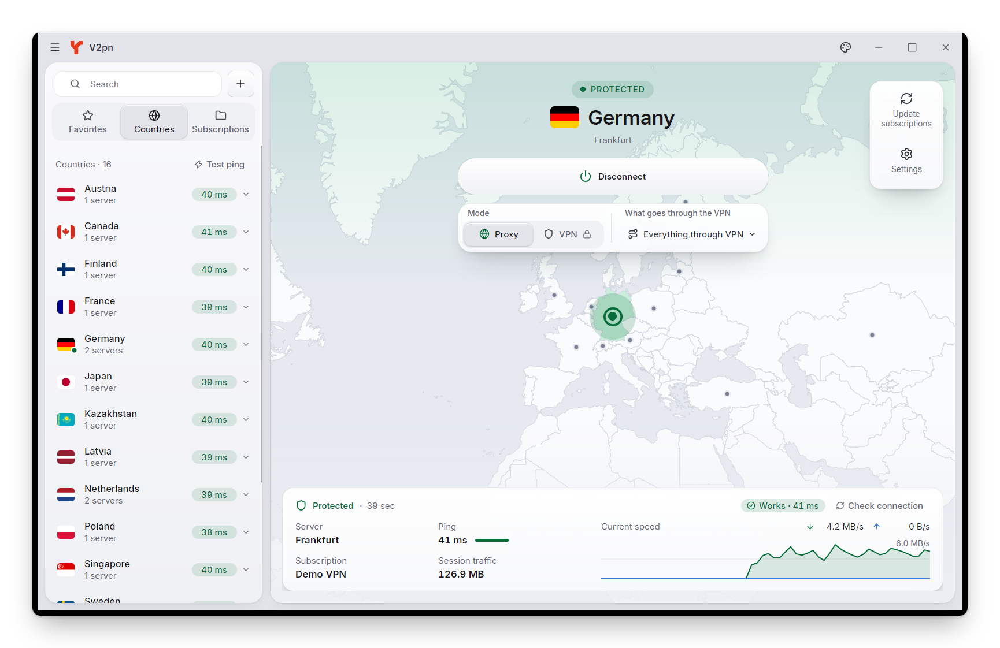
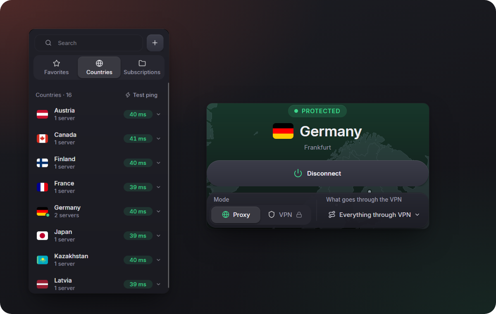
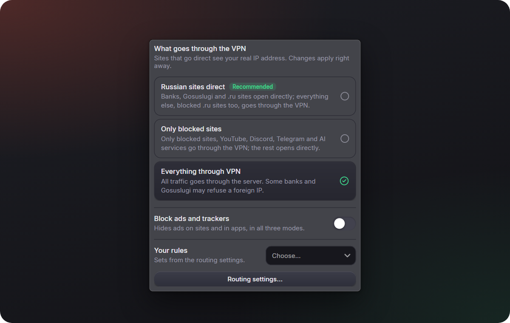
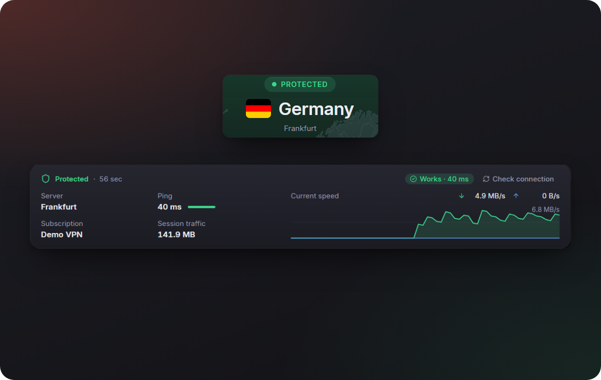
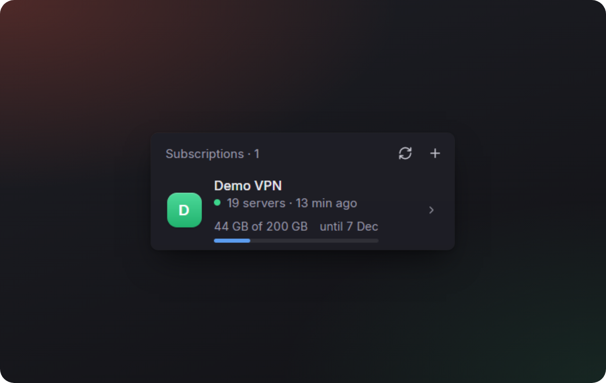
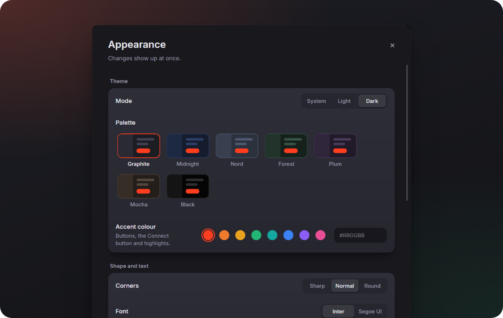
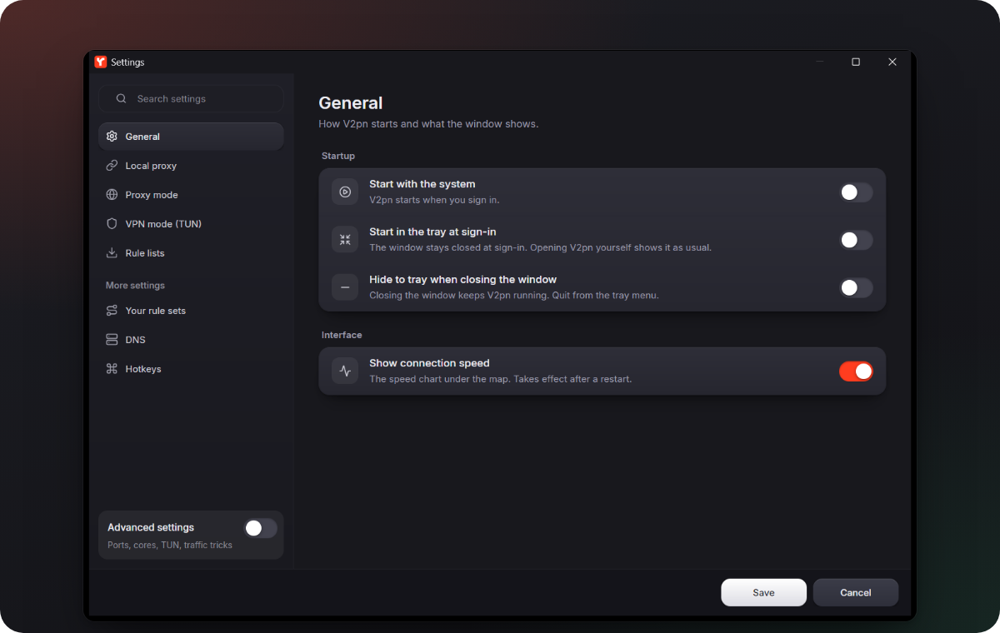
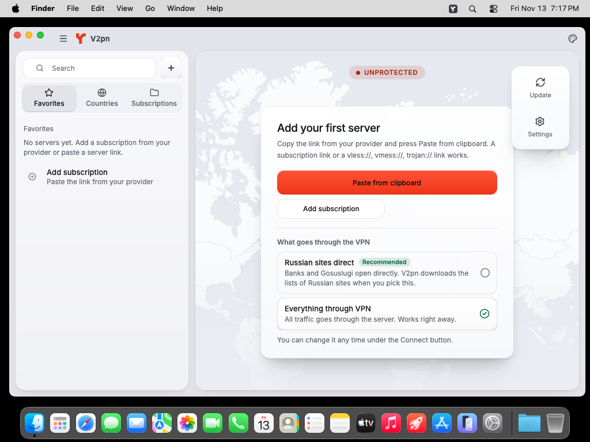

<p align="center">
  
</p>

<h1 align="center">V2pn</h1>

<p align="center">
  <b>A simple VPN client for Windows and macOS.</b><br>
  Your provider's VLESS, VMess, Trojan, Shadowsocks, Hysteria2, TUIC and WireGuard servers, one click away.
</p>

<p align="center">
  <a href="https://github.com/Piwqust/V2pn/releases/latest"></a>
  <a href="https://github.com/Piwqust/V2pn/releases"></a>
  <a href="https://github.com/Piwqust/V2pn/actions/workflows/v2pn-ci.yml"></a>
  <a href="LICENSE"></a>
</p>

<p align="center">
  <a href="https://github.com/Piwqust/V2pn/releases/latest/download/V2pn-windows-x64.zip"></a>
  &nbsp;
  <a href="https://github.com/Piwqust/V2pn/releases/latest/download/V2pn-macos-arm64.dmg"></a>
</p>

<p align="center">
  <sub>
    Windows 10 and 11, x64 · <a href="https://github.com/Piwqust/V2pn/releases/latest/download/V2pn-windows-arm64.zip">Windows on ARM</a>
    &nbsp;&nbsp;|&nbsp;&nbsp;
    macOS 13.6 or later, Apple silicon · <a href="https://github.com/Piwqust/V2pn/releases/latest/download/V2pn-macos-x64.dmg">Intel Mac</a>
  </sub>
</p>

<p align="center"><a href="README.ru.md">Русский</a> · <a href="CHANGELOG.md">What's new</a> · <a href="https://github.com/Piwqust/V2pn/releases">All releases</a></p>

<p align="center">
  <picture>
    <source media="(prefers-color-scheme: dark)" srcset="docs/images/screenshot-dark.png">
    
  </picture>
</p>

V2pn runs [v2rayN](https://github.com/2dust/v2rayN) with the Xray, sing-box and mihomo cores inside, so every server and subscription that works in v2rayN works here. The difference is the screen in front of it: one window where you pick a server, choose Proxy or VPN, decide what goes through the VPN, and press Connect.

## What it does

<table>
  <tr>
    <td width="50%" valign="top">
      
      <h3>Every country, one click</h3>
      Servers are grouped by country, with live ping. Favorites, the servers you used last and the fastest one sit on top; numbered series like “AUTO 1/34” collapse into a single row.
    </td>
    <td width="50%" valign="top">
      
      <h3>Choose what goes through the VPN</h3>
      Three presets: Russian sites direct, only blocked sites, or everything. Banks and government sites keep working, and an ad and tracker blocker is one switch away. No rule editor needed.
    </td>
  </tr>
  <tr>
    <td width="50%" valign="top">
      
      <h3>A status you can trust</h3>
      “Protected” appears only after a real connection check. Ping, speed and session traffic are live; when a server stops answering, V2pn offers another one from the same country.
    </td>
    <td width="50%" valign="top">
      
      <h3>Subscriptions that keep your choices</h3>
      Traffic left and the plan's end date are shown in the list. Updating a subscription keeps your favorites, recent servers and pings.
    </td>
  </tr>
  <tr>
    <td width="50%" valign="top">
      
      <h3>Make it yours</h3>
      Light or dark, seven palettes, any accent colour, sharp or round corners. Changes show up at once.
    </td>
    <td width="50%" valign="top">
      
      <h3>Settings in plain words</h3>
      The everyday settings fit on one page. Everything v2rayN can do (routing rules, DNS, cores, custom configs) is still there behind “Advanced settings”.
    </td>
  </tr>
</table>

## Install

### Windows

**One command.** Open Terminal (<kbd>Win</kbd>+<kbd>X</kbd> → Terminal) and run:

```powershell
irm https://github.com/Piwqust/V2pn/releases/latest/download/install.ps1 | iex
```

The script downloads the newest version, checks it against the release's list of files, installs it to `%LOCALAPPDATA%\Programs\V2pn`, adds Start menu and desktop shortcuts and starts V2pn. No administrator rights, no SmartScreen window. If v2rayN is on the computer, V2pn takes its servers and settings right away (see [Moving from v2rayN](#moving-from-v2rayn)).

**By hand:**

1. Download [V2pn-windows-x64.zip](https://github.com/Piwqust/V2pn/releases/latest/download/V2pn-windows-x64.zip) ([ARM64](https://github.com/Piwqust/V2pn/releases/latest/download/V2pn-windows-arm64.zip) for Windows on ARM).
2. Unpack it into a folder you can write to, for example `C:\Users\<you>\V2pn`. Not `Program Files`: settings and servers are kept next to the program.
3. Run `V2pn.exe`. Windows may show “Windows protected your PC”, because the app has no paid developer signature: press **More info**, then **Run anyway**.

.NET does not need to be installed; it is inside.

### macOS

<p align="center"></p>

**One command.** Open Terminal (Applications → Utilities → Terminal) and run:

```bash
curl -fsSL https://github.com/Piwqust/V2pn/releases/latest/download/install.sh | bash
```

The script picks the build for your Mac, checks it against the release's list of files, puts V2pn into Applications and opens it, without the “unverified developer” warning. If v2rayN is on the Mac, V2pn takes its servers and settings right away.

**By hand:**

1. Download the build for your Mac: [Apple silicon](https://github.com/Piwqust/V2pn/releases/latest/download/V2pn-macos-arm64.dmg) (M1 and later) or [Intel](https://github.com/Piwqust/V2pn/releases/latest/download/V2pn-macos-x64.dmg). Not sure which? Apple menu  → About This Mac: “Chip Apple M…” is Apple silicon, “Processor Intel” is Intel.
2. Open the `.dmg` and drag V2pn to Applications.
3. Start V2pn. macOS says it cannot verify the developer: the app is not signed with a paid Apple certificate. Open System Settings → Privacy & Security, scroll down and press **Open Anyway** next to V2pn. This is needed once.

If there is no **Open Anyway**, run `xattr -cr /Applications/V2pn.app` in Terminal and start V2pn again.

**On a Mac:**

- V2pn has an icon in the menu bar and can keep running there with the window closed: Settings → General → “Hide to tray when closing the window”. <kbd>⌘</kbd>+<kbd>Q</kbd> quits.
- VPN mode asks for your Mac password: it creates a network interface, which macOS allows only to an administrator.
- Settings and servers are in `~/Library/Application Support/V2pn`.
- The macOS build is new: an automated check builds it and starts it on a Mac, but few people have used it on real machines yet. If something does not work, [open an issue](https://github.com/Piwqust/V2pn/issues/new/choose).

## Getting started

1. Copy the subscription link from your VPN provider, or a server link such as `vless://…`.
2. In V2pn press **Paste from clipboard** (<kbd>Ctrl</kbd>+<kbd>V</kbd>, on a Mac <kbd>⌘</kbd>+<kbd>V</kbd>).
3. Pick a server in the list or on the map and press **Connect**.

If your provider's bot or site has a **Connect in V2pn** button, press it instead: V2pn adds the subscription, and a provider that works with V2pn gets its own tab in the title bar. For providers: [v2pn.angleford.co/providers](https://v2pn.angleford.co/providers/).

Two choices sit under the button:

- **Proxy or VPN.** Proxy turns on the system proxy: browsers and programs that use it go through the server. VPN routes all traffic of the computer, games included; it needs administrator rights on Windows and your password on macOS.
- **What goes through the VPN.** Russian sites direct, blocked sites only, or everything through the VPN. You can change it at any time, connected or not.

## Moving from v2rayN

V2pn keeps its data in the same files as v2rayN, so moving takes one button. When a v2rayN with servers is on the computer, V2pn offers **Move from v2rayN** at its first start: servers, subscriptions, routing and settings. Later it is in the ☰ menu → **Tools** → **Move from v2rayN…**. The one-command install moves them by itself.

- v2rayN is closed and no longer starts with the system. Its own files stay as they are, so you can go back to it.
- What V2pn had before the move is kept in `guiTemps\V2pnImportBackup-<date>`.
- Cores V2pn lacks are taken from v2rayN's folder.
- On Windows V2pn finds v2rayN by its sign-in entry, a running copy, the WinGet and Scoop folders, `%LOCALAPPDATA%\v2rayN`, and in Downloads, Desktop, Documents and Program Files.
- A v2rayN running as administrator cannot be closed by V2pn; it then asks you to quit v2rayN from its tray icon.

## How V2pn differs from v2rayN

- **The status tells the truth.** “Connected” appears after a successful connection check, not after the button is pressed. If the core dies, V2pn restarts it; after five failures in a row it disconnects and says why.
- **The internet does not disappear after exit.** The system proxy is set only while the core runs and is cleared on exit, shutdown and a crash. A proxy set by another program is left alone.
- **A busy port is named.** If another program holds the port, V2pn does not start on top of it and says so.
- **One place for settings.** The Settings window holds the everyday options; routing rules, DNS and hotkeys open from its “More settings” section.
- **It updates itself,** with signed packages and a rollback (see below).

## Updates

Every six hours V2pn checks for a new version, downloads it in the background and installs it at the next start or when you press **Restart and update**. A running connection is never cut by an update. Automatic installation can be turned off in the Updates window.

- Every release is signed with a key whose public half is built into the app. V2pn will not install a package without that signature, a changed one or an incomplete one, wherever it was downloaded from.
- If the new version does not start, the installer puts the previous one back.
- Settings, servers and cores are not touched by an update.
- Cores (Xray, sing-box, mihomo) and site lists are updated separately in the same window.

What exactly is checked before installing: [docs/V2PN-RELEASES.md](docs/V2PN-RELEASES.md#what-exactly-is-checked).

## Keyboard

| | Windows | macOS |
| --- | --- | --- |
| Paste a server or subscription | <kbd>Ctrl</kbd>+<kbd>V</kbd> | <kbd>⌘</kbd>+<kbd>V</kbd> |
| Search servers | <kbd>Ctrl</kbd>+<kbd>F</kbd> | <kbd>⌘</kbd>+<kbd>F</kbd> |
| Favorites, Countries, Subscriptions | <kbd>Ctrl</kbd>+<kbd>1</kbd> … <kbd>3</kbd> | <kbd>⌘</kbd>+<kbd>1</kbd> … <kbd>3</kbd> |
| Add the selected server to favorites | <kbd>Ctrl</kbd>+<kbd>B</kbd> | <kbd>⌘</kbd>+<kbd>B</kbd> |
| Test ping of all servers | <kbd>Ctrl</kbd>+<kbd>Shift</kbd>+<kbd>R</kbd> | <kbd>⌘</kbd>+<kbd>Shift</kbd>+<kbd>R</kbd> |
| Settings | <kbd>Ctrl</kbd>+<kbd>,</kbd> | <kbd>⌘</kbd>+<kbd>,</kbd> |
| Restart the connection | <kbd>F5</kbd> | <kbd>F5</kbd> |

## Uninstall

- **Windows:** quit V2pn from its tray icon, then delete `%LOCALAPPDATA%\Programs\V2pn` (or the folder you unpacked it to) and its shortcuts. Settings and servers are inside that folder.
- **macOS:** quit V2pn, move it from Applications to the Bin, and delete `~/Library/Application Support/V2pn`.

## Building from source

You need the [.NET 10 SDK](https://dot.net).

```bash
git clone --recursive https://github.com/Piwqust/V2pn.git
dotnet build V2pn/v2rayN/v2rayN.Desktop/v2rayN.Desktop.csproj -c Release
dotnet test --project V2pn/v2rayN/ServiceLib.Tests/ServiceLib.Tests.csproj -c Release
```

The sources live in the `v2rayN/` folder: the name is kept from the original so that its updates merge without conflicts. For the same reason the root holds v2rayN's `package-*.sh` scripts; V2pn does not use them.

A build from source shows its version with `-dev` and does not update itself. Release packages are made by `tools/release.ps1` (Windows) and `tools/package-macos.sh` (macOS); screenshots like the ones above come from a sandbox with the demo subscription in `tools/demo`.

Developer documentation:

- [docs/V2PN-UX.md](docs/V2PN-UX.md): how the interface is built and why;
- [docs/V2PN-RELEASES.md](docs/V2PN-RELEASES.md): releases, updates, the mirror, merging v2rayN.

## License and credits

[GPL-3.0](LICENSE), the same as v2rayN. V2pn is a fork of [2dust/v2rayN](https://github.com/2dust/v2rayN): connecting, protocols, subscriptions and core handling are the work of its authors. Cores: [Xray-core](https://github.com/XTLS/Xray-core), [sing-box](https://github.com/SagerNet/sing-box), [mihomo](https://github.com/MetaCubeX/mihomo). Icons: [Lucide](https://lucide.dev); the Apple logo on the download button is from [Simple Icons](https://simpleicons.org).

V2pn does not sell or provide servers. You need your own subscription or server. Found a security problem? See [SECURITY.md](SECURITY.md).
