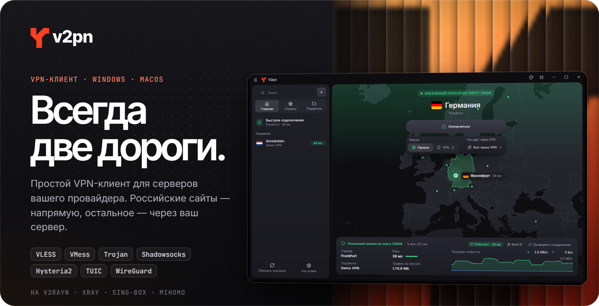
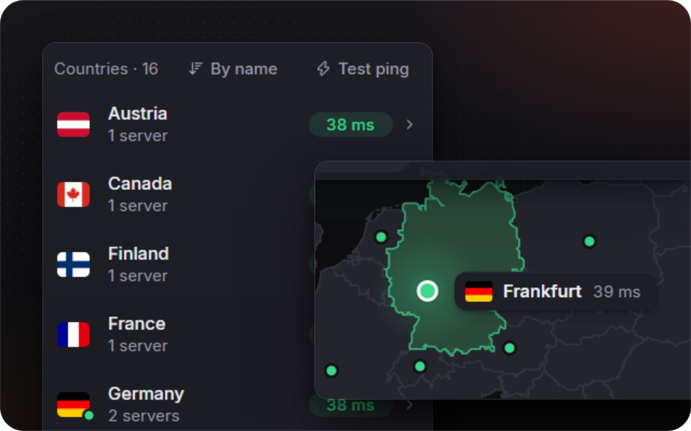
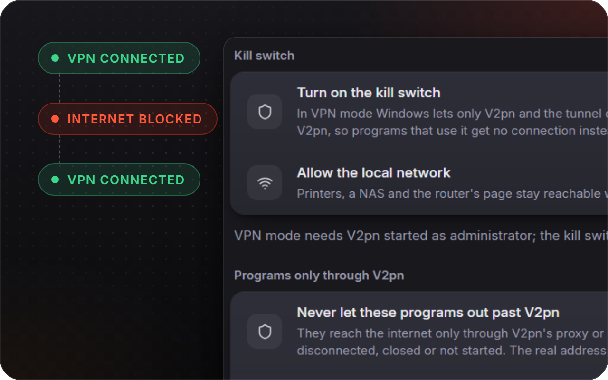
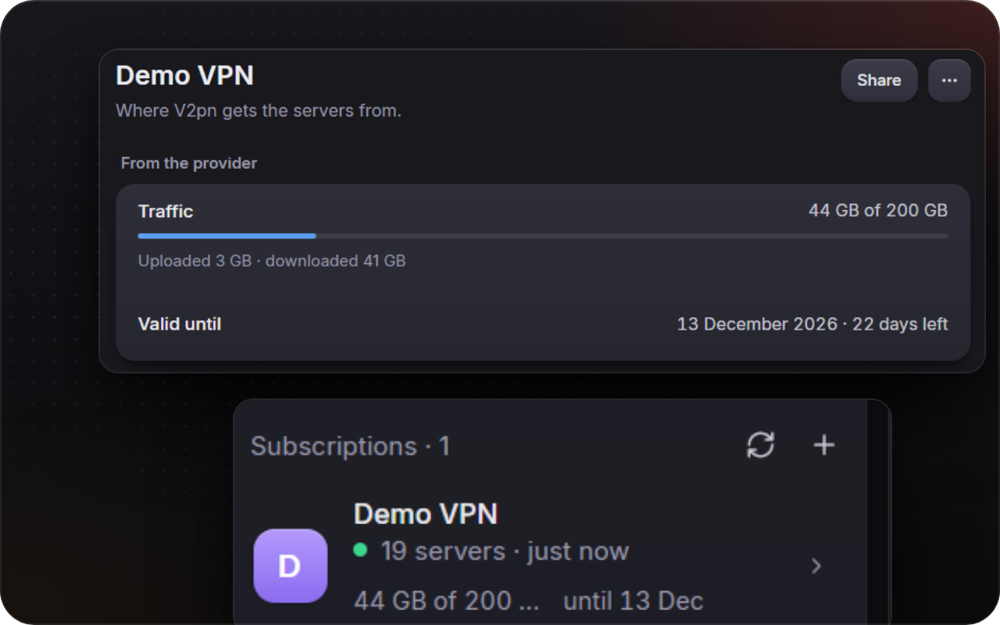
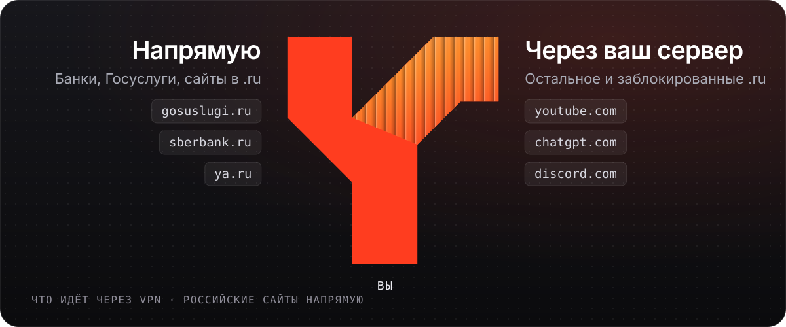

<p align="center">
  <a href="https://v2pn.angleford.co/"></a>
</p>

<p align="center">
  <a href="https://github.com/Piwqust/V2pn/releases/latest/download/V2pn-windows-x64-setup.exe"></a>
  &nbsp;
  <a href="https://github.com/Piwqust/V2pn/releases/latest/download/V2pn-macos-arm64.dmg"></a>
</p>

<p align="center">
  <sub>
    Windows 10 и 11 · x64 или <a href="https://github.com/Piwqust/V2pn/releases/latest/download/V2pn-windows-arm64-setup.exe">ARM64</a>
    &nbsp;&nbsp;·&nbsp;&nbsp;
    macOS 13.6 и новее · Apple silicon или <a href="https://github.com/Piwqust/V2pn/releases/latest/download/V2pn-macos-x64.dmg">Intel</a>
  </sub>
</p>

<p align="center">
  <a href="https://github.com/Piwqust/V2pn/releases/latest"></a>
  <a href="https://github.com/Piwqust/V2pn/releases"></a>
  <a href="https://github.com/Piwqust/V2pn/actions/workflows/v2pn-ci.yml"></a>
  <a href="LICENSE"></a>
</p>

<p align="center">
  <a href="#установка"><b>Установка</b></a>
  &nbsp;·&nbsp; <a href="#что-умеет">Что умеет</a>
  &nbsp;·&nbsp; <a href="#две-дороги">Две дороги</a>
  &nbsp;·&nbsp; <a href="#переезд-с-v2rayn">С v2rayN</a>
  &nbsp;·&nbsp; <a href="CHANGELOG.md">Что нового</a>
  &nbsp;·&nbsp; <a href="https://v2pn.angleford.co/">Сайт</a>
  &nbsp;·&nbsp; <a href="README.md">English</a>
</p>

<br>

**V2pn** — VPN-клиент для серверов, которые дал вам провайдер: VLESS, VMess, Trojan, Shadowsocks, Hysteria2, TUIC и WireGuard. Внутри работает [v2rayN](https://github.com/2dust/v2rayN) с ядрами Xray, sing-box и mihomo, поэтому подходят все серверы и подписки, которые работают в v2rayN. Снаружи — одно окно: выбрать страну, режим «Прокси» или VPN, что идёт через VPN, и нажать **Подключиться**.

> [!NOTE]
> V2pn не продаёт и не раздаёт серверы. Нужна ссылка на подписку от VPN-провайдера или свой сервер.

## Что умеет

<table>
  <tr>
    <td width="50%" valign="top">
      
      <h3>Любая страна в один клик</h3>
      Серверы сгруппированы по странам, пинг виден сразу. Карта приближается к стране и ставит булавку в город. Избранное, недавние и самый быстрый сервер — на вкладке «Главная»; нумерованные серии вроде «AUTO 1/34» собраны в одну строку.
    </td>
    <td width="50%" valign="top">
      
      <h3>Статусу можно верить</h3>
      Статус становится зелёным только после настоящей проверки соединения. Пинг, скорость и трафик за сессию видны вживую. Если сервер перестал отвечать, V2pn предложит другой из той же страны.
    </td>
  </tr>
  <tr>
    <td width="50%" valign="top">
      
      <h3>Kill switch <sup><kbd>1.4</kbd></sup></h3>
      Если соединение упало, интернет остаётся закрытым, пока V2pn не переподключится или вы не нажмёте «Отключиться». На Windows программы из вашего списка, например Claude, выходят в интернет только через V2pn и отрезаны, пока он выключен. По умолчанию выключен.
    </td>
    <td width="50%" valign="top">
      
      <h3>Обход блокировок <sup><kbd>1.4</kbd></sup></h3>
      Одной фразой говорит, что блокирует ваша сеть: весь интернет, белый список, адрес сервера или загрузки, которые замирают после первых ~16 КБ. Затем пробует способы разбить TLS-рукопожатие и запоминает рабочий для каждой сети. По умолчанию выключен.
    </td>
  </tr>
  <tr>
    <td width="50%" valign="top">
      
      <h3>Подписки помнят ваш выбор</h3>
      В списке видно, сколько трафика осталось и до какого числа оплачено. Обновление подписки сохраняет избранное, недавние серверы и пинг.
    </td>
    <td width="50%" valign="top">
      
      <h3>Под себя</h3>
      Светлая или тёмная тема, семь палитр, любой цвет акцента, острые или круглые углы. Изменения видны сразу.
    </td>
  </tr>
</table>

<sub>На снимках интерфейс на английском, языке по умолчанию. Русский выбирается при первом запуске, позже — в «Оформлении».</sub>

## Две дороги

<p align="center">
  
</p>

Знак — это дорога, если смотреть сверху: въезд один, выезда два. По какой дороге пойдёт трафик, решают два выбора под кнопкой **Подключиться**.

**Что идёт через VPN.** Менять можно в любой момент, с подключением и без.

| Пресет | Напрямую | Через ваш сервер |
| --- | --- | --- |
| **Российские сайты напрямую** · рекомендуем | Банки, Госуслуги и сайты в `.ru` | Всё остальное, и заблокированные `.ru` тоже |
| **Только заблокированное** | Всё остальное | Заблокированное, YouTube, Discord, Telegram и ИИ |
| **Всё через VPN** | — | Весь трафик; некоторые банки и Госуслуги не пускают с иностранного IP |

Блокировка рекламы и трекеров включается одним переключателем в том же меню и работает со всеми тремя. Там же — свои наборы правил; для пресетов редактор правил не нужен.

**Прокси или VPN.** «Прокси» включает системный прокси: через сервер идут браузеры и программы, которые его используют. VPN пускает через сервер весь трафик компьютера, включая игры; на Windows ему нужны права администратора, на macOS — пароль.

## Установка

### Windows

Откройте Терминал (<kbd>Win</kbd>+<kbd>X</kbd> → Терминал) и выполните:

```powershell
irm https://github.com/Piwqust/V2pn/releases/latest/download/install.ps1 | iex
```

Скрипт скачает последнюю версию, сверит её со списком файлов релиза, поставит в `%LOCALAPPDATA%\Programs\V2pn`, добавит ярлыки в меню «Пуск» и на рабочий стол и запустит V2pn. Права администратора не нужны, окна SmartScreen не будет. Если на компьютере есть v2rayN, V2pn сразу заберёт его серверы и настройки.

<details>
<summary><b>Установить вручную или портативная версия</b></summary>
<br>

1. Скачайте [V2pn-windows-x64-setup.exe](https://github.com/Piwqust/V2pn/releases/latest/download/V2pn-windows-x64-setup.exe) ([ARM64](https://github.com/Piwqust/V2pn/releases/latest/download/V2pn-windows-arm64-setup.exe) для Windows на ARM).
2. Запустите его. Windows может показать «Система Windows защитила ваш компьютер»: у приложения нет платной подписи разработчика. Нажмите **Подробнее**, затем **Выполнить в любом случае**.
3. Установщик поставит V2pn в `%LOCALAPPDATA%\Programs\V2pn` для вашего пользователя Windows, без прав администратора, добавит его в меню «Пуск» (и на рабочий стол, если не снимать галочку) и предложит забрать серверы из v2rayN.

**Портативная версия:** [V2pn-windows-x64.zip](https://github.com/Piwqust/V2pn/releases/latest/download/V2pn-windows-x64.zip) ([ARM64](https://github.com/Piwqust/V2pn/releases/latest/download/V2pn-windows-arm64.zip)) — то же приложение. Распакуйте в папку, куда можно писать (не в `Program Files`: настройки и серверы лежат рядом с программой), и запустите `V2pn.exe`.

Ставить .NET не нужно, он внутри.

</details>

### macOS

Откройте Терминал («Программы» → «Утилиты» → «Терминал») и выполните:

```bash
curl -fsSL https://github.com/Piwqust/V2pn/releases/latest/download/install.sh | bash
```

Скрипт выберет сборку для вашего Mac, сверит её со списком файлов релиза, положит V2pn в «Программы» и откроет, без предупреждения о непроверенном разработчике. Если на Mac есть v2rayN, V2pn сразу заберёт его серверы и настройки.

<details>
<summary><b>Установить вручную</b></summary>
<br>

1. Скачайте сборку для своего Mac: [Apple silicon](https://github.com/Piwqust/V2pn/releases/latest/download/V2pn-macos-arm64.dmg) (M1 и новее) или [Intel](https://github.com/Piwqust/V2pn/releases/latest/download/V2pn-macos-x64.dmg). Не знаете какой? Меню  → «Об этом Mac»: «Чип Apple M…» — это Apple silicon, «Процессор Intel» — Intel.
2. Откройте `.dmg` и перетащите V2pn в «Программы».
3. Запустите V2pn. macOS скажет, что не может проверить разработчика: приложение не подписано платным сертификатом Apple. Откройте «Системные настройки» → «Конфиденциальность и безопасность», прокрутите вниз и нажмите **Всё равно открыть** рядом с V2pn. Это нужно один раз.

Если кнопки **Всё равно открыть** нет, выполните в Терминале `xattr -cr /Applications/V2pn.app` и запустите V2pn снова.

</details>

<details>
<summary><b>На Mac</b></summary>
<br>

<p align="center"></p>

- У V2pn есть значок в строке меню, и он может работать там с закрытым окном: «Настройки» → «Общие» → «Сворачивать в трей при закрытии». <kbd>⌘</kbd>+<kbd>Q</kbd> выходит из программы.
- Режим VPN спрашивает пароль от Mac: он создаёт сетевой интерфейс, а это macOS разрешает только администратору.
- Настройки и серверы лежат в `~/Library/Application Support/V2pn`.
- Сборка для macOS новая: автоматическая проверка собирает её и запускает на Mac, но на настоящих компьютерах ею пользовались немногие. Если что-то не работает, [напишите об этом](https://github.com/Piwqust/V2pn/issues/new/choose).

</details>

## Первое подключение

1. Скопируйте ссылку на подписку у вашего VPN-провайдера или ссылку на сервер вида `vless://…`.
2. В V2pn нажмите **Вставить из буфера** (<kbd>Ctrl</kbd>+<kbd>V</kbd>, на Mac <kbd>⌘</kbd>+<kbd>V</kbd>).
3. Выберите сервер в списке или на карте и нажмите **Подключиться**.

При первом запуске V2pn спросит язык (русский или английский) и проведёт по этим шагам. Если в боте или на сайте провайдера есть кнопка **Подключить в V2pn**, нажмите её: V2pn добавит подписку сам.

> [!TIP]
> **Провайдерам.** Провайдер, который работает с V2pn, получает свою вкладку в заголовке окна: со своим знаком, цветами, тарифом и только своими серверами. Одна форма, без ключей, хостинга и отдельной сборки: [v2pn.angleford.co/providers](https://v2pn.angleford.co/providers/) · [руководство](docs/partners/README.ru.md).

**Из терминала и ИИ-ассистентов.** Вместе с V2pn ставится `v2pnctl`, а установленный V2pn для Windows, winget и Homebrew добавляют его в PATH: `v2pnctl status`, `v2pnctl servers`, `v2pnctl use Frankfurt`, `v2pnctl connect`, `v2pnctl route all`, остальное в `v2pnctl --help`. `v2pnctl mcp` — MCP-сервер для Claude Code, Claude Desktop, Cursor и других: `claude mcp add v2pn -- v2pnctl mcp`. Он выключен, пока вы не включите его в «Настройки → Общие → Управление из командной строки и ИИ» (только чтение или с управлением). О каждом изменении V2pn говорит в окне, а ссылки, адреса и ключи не выдаёт никогда.

## Переезд с v2rayN

V2pn хранит данные в тех же файлах, что и v2rayN, поэтому переезд занимает одну кнопку. Если на компьютере есть v2rayN с серверами, при первом запуске V2pn предложит **Перенести из v2rayN**: серверы, подписки, маршруты и настройки. Позже это есть в меню ☰ → **Сервис** → **Перенести из v2rayN…**. Установка одной командой переносит сама.

- v2rayN закрывается и перестаёт запускаться вместе с системой. Его файлы не меняются, к нему можно вернуться.
- То, что было в V2pn до переезда, сохраняется в `guiTemps\V2pnImportBackup-<дата>`.
- Ядра, которых нет у V2pn, берутся из папки v2rayN.
- На Windows V2pn находит v2rayN по записи автозапуска, по запущенной копии, в папках WinGet и Scoop, в `%LOCALAPPDATA%\v2rayN`, а также в «Загрузках», на рабочем столе, в «Документах» и в Program Files.
- v2rayN, запущенный от администратора, V2pn закрыть не может; тогда он просит выйти из v2rayN через значок в трее.

### Чем V2pn отличается от v2rayN

- **Статус говорит правду.** «Подключено» появляется после успешной проверки соединения, а не после нажатия кнопки. Если ядро упало, V2pn перезапускает его; после пяти неудач подряд отключается и пишет причину.
- **Интернет не пропадает после выхода.** Системный прокси включён, только пока работает ядро, и снимается при выходе, выключении компьютера и аварийном завершении. Чужой прокси V2pn не трогает.
- **Занятый порт назван.** Если порт держит другая программа, V2pn не запускается поверх неё и сообщает об этом.
- **Настройки человеческим языком.** Повседневное умещается на одной странице. Правила маршрутизации, DNS, ядра и свои конфиги остались — в «Других настройках» и «Расширенных настройках».
- **Обновляется сам,** подписанными пакетами и с откатом (см. ниже).

## Обновления

Раз в шесть часов V2pn проверяет, вышла ли новая версия, скачивает её в фоне и ставит при следующем запуске или по кнопке **Перезапустить и обновить**. Работающее соединение обновление не обрывает. Автоматическую установку можно выключить в окне «Обновления».

- Каждый релиз подписан ключом, открытая часть которого встроена в приложение. Пакет без подписи, изменённый или недокачанный V2pn не поставит, откуда бы его ни скачали.
- Если новая версия не запустилась, установщик возвращает предыдущую.
- Обновление не трогает настройки, серверы и ядра.
- Ядра (Xray, sing-box, mihomo) и списки сайтов обновляются отдельно, в том же окне.

Что именно проверяется перед установкой: [docs/V2PN-RELEASES.md](docs/V2PN-RELEASES.md#what-exactly-is-checked) (на английском).

<details>
<summary><b>Клавиатура</b></summary>
<br>

| | Windows | macOS |
| --- | --- | --- |
| Вставить сервер или подписку | <kbd>Ctrl</kbd>+<kbd>V</kbd> | <kbd>⌘</kbd>+<kbd>V</kbd> |
| Поиск серверов | <kbd>Ctrl</kbd>+<kbd>F</kbd> | <kbd>⌘</kbd>+<kbd>F</kbd> |
| Главная, Страны, Подписки | <kbd>Ctrl</kbd>+<kbd>1</kbd> … <kbd>3</kbd> | <kbd>⌘</kbd>+<kbd>1</kbd> … <kbd>3</kbd> |
| Добавить выбранный сервер в избранное | <kbd>Ctrl</kbd>+<kbd>B</kbd> | <kbd>⌘</kbd>+<kbd>B</kbd> |
| Проверить пинг всех серверов | <kbd>Ctrl</kbd>+<kbd>Shift</kbd>+<kbd>R</kbd> | <kbd>⌘</kbd>+<kbd>Shift</kbd>+<kbd>R</kbd> |
| Сканировать QR-код на экране | <kbd>Ctrl</kbd>+<kbd>S</kbd> | |
| Настройки | <kbd>Ctrl</kbd>+<kbd>,</kbd> | <kbd>⌘</kbd>+<kbd>,</kbd> |
| Перезапустить подключение | <kbd>F5</kbd> | <kbd>F5</kbd> |

</details>

<details>
<summary><b>Удаление</b></summary>
<br>

- **Windows, установлен установщиком:** «Параметры» → «Приложения» → «Установленные приложения» → V2pn. Он спросит, сохранить ли серверы и настройки для следующей установки.
- **Windows, установлен командой или распакован из zip:** выйдите из V2pn через значок в трее и удалите `%LOCALAPPDATA%\Programs\V2pn` (или папку, куда распаковали) и ярлыки. Настройки и серверы лежат в этой же папке.
- **macOS:** выйдите из V2pn, перенесите его из «Программ» в Корзину и удалите `~/Library/Application Support/V2pn`.

</details>

## Сборка из исходников

Нужен [.NET 10 SDK](https://dot.net).

```bash
git clone --recursive https://github.com/Piwqust/V2pn.git
dotnet build V2pn/v2rayN/v2rayN.Desktop/v2rayN.Desktop.csproj -c Release
dotnet test --project V2pn/v2rayN/ServiceLib.Tests/ServiceLib.Tests.csproj -c Release
```

Исходники лежат в папке `v2rayN/`: имя оставлено от оригинала, чтобы его обновления сливались без конфликтов. По той же причине в корне лежат скрипты v2rayN `package-*.sh`; V2pn ими не пользуется.

Сборка из исходников показывает версию с `-dev` и сама не обновляется. Пакеты для релизов собирают `tools/release.ps1` (Windows) и `tools/package-macos.sh` (macOS); снимки экрана делаются в песочнице с демо-подпиской из `tools/demo`.

| Для разработчиков | |
| --- | --- |
| [docs/V2PN-UX.md](docs/V2PN-UX.md) | Как устроен интерфейс и почему (на английском) |
| [docs/V2PN-RELEASES.md](docs/V2PN-RELEASES.md) | Релизы, обновления, зеркало, слияние с v2rayN (на английском) |
| [docs/partners/README.ru.md](docs/partners/README.ru.md) | Вкладки провайдеров: форма, заголовки, которые читает V2pn, файл партнёра |
| [CHANGELOG.md](CHANGELOG.md) | Что менялось в каждой версии, с картинками (на английском) |

## Лицензия и благодарности

[GPL-3.0](LICENSE), как у v2rayN. V2pn — форк [2dust/v2rayN](https://github.com/2dust/v2rayN): подключение, протоколы, подписки и работа с ядрами — заслуга его авторов. Ядра: [Xray-core](https://github.com/XTLS/Xray-core), [sing-box](https://github.com/SagerNet/sing-box), [mihomo](https://github.com/MetaCubeX/mihomo). Иконки: [Lucide](https://lucide.dev); логотип Apple на кнопке скачивания — из [Simple Icons](https://simpleicons.org).

Нашли уязвимость? Смотрите [SECURITY.md](SECURITY.md). Что-то не работает? [Напишите об этом](https://github.com/Piwqust/V2pn/issues/new/choose).

<br>

<p align="center">
  <a href="https://v2pn.angleford.co/">
    <picture>
      <source media="(prefers-color-scheme: dark)" srcset="docs/images/readme/lockup-dark.svg">
      
    </picture>
  </a>
  <br>
  <sub>Всегда две дороги.</sub>
</p>
