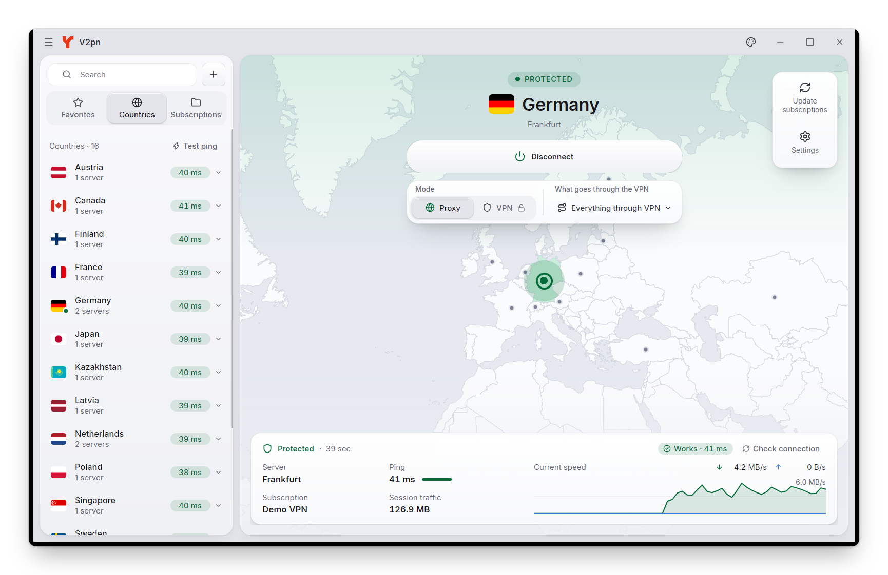
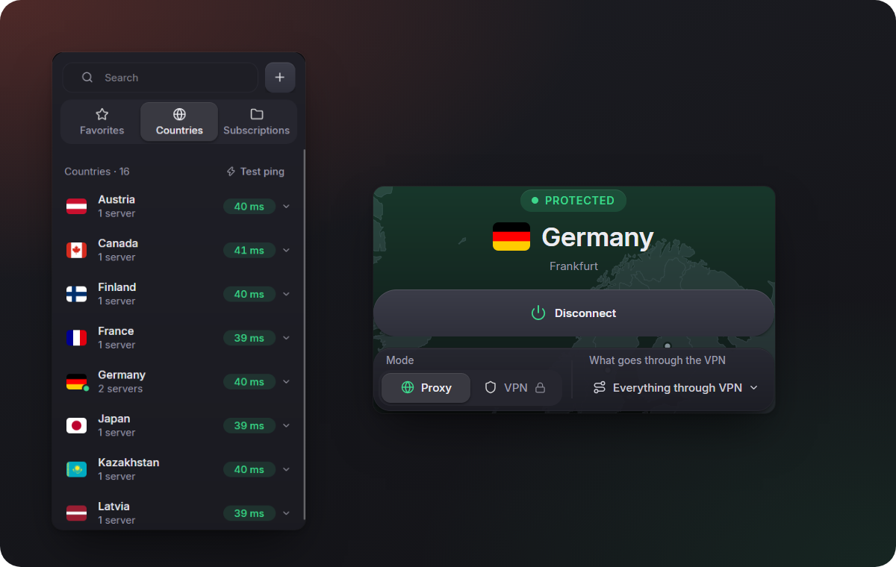
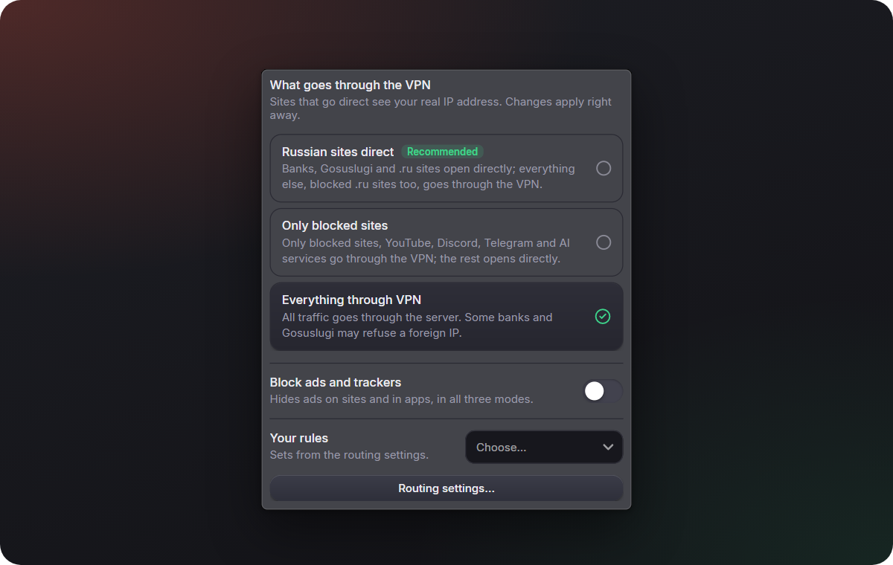
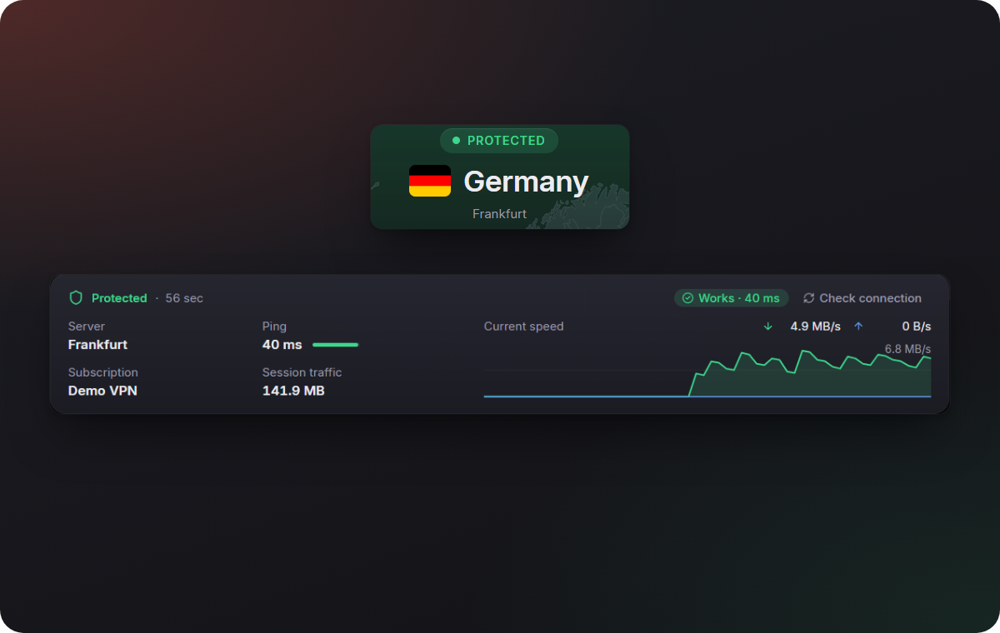
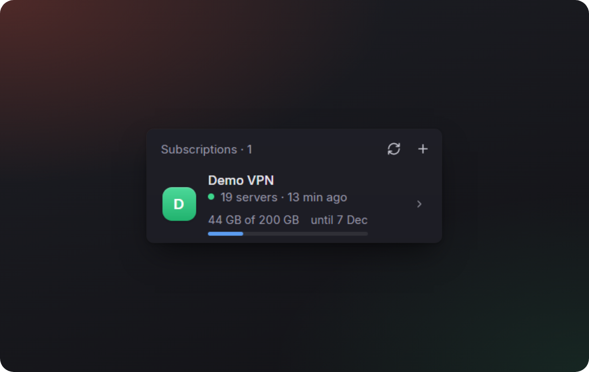
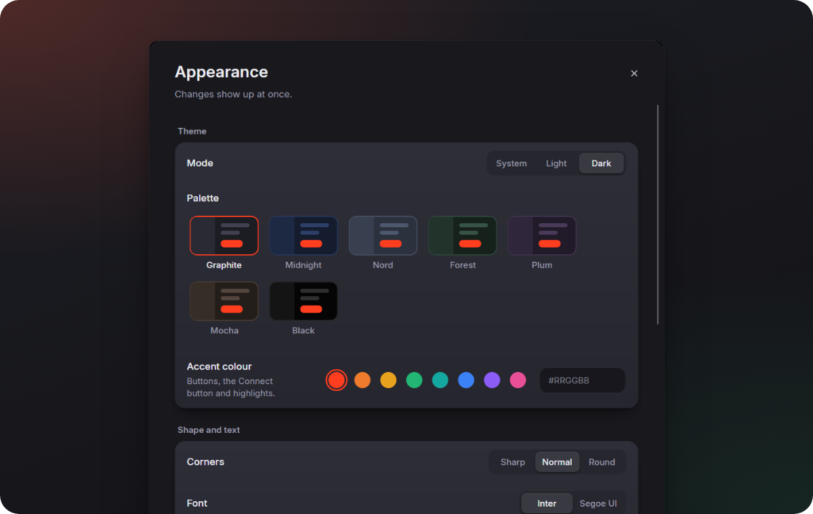
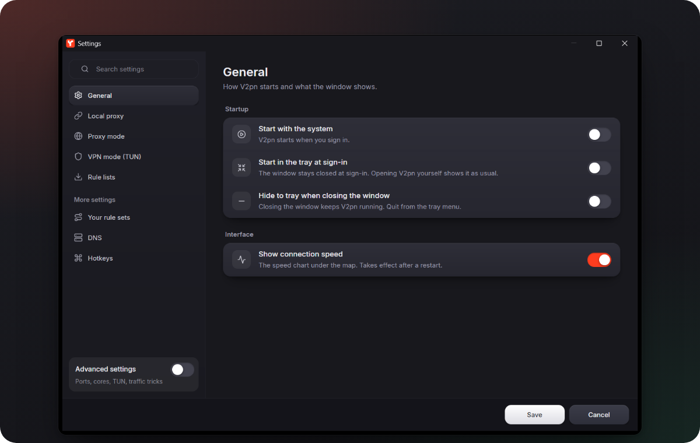
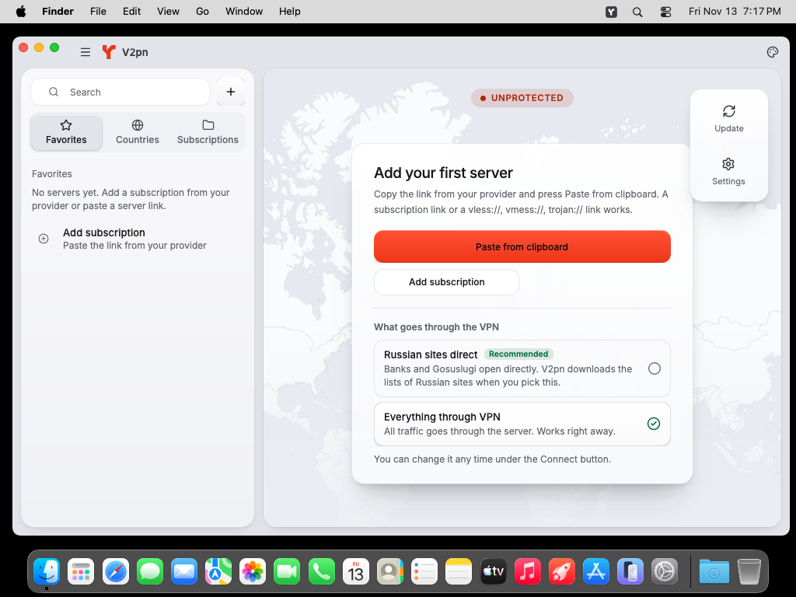

<p align="center">
  
</p>

<h1 align="center">V2pn</h1>

<p align="center">
  <b>Простой VPN-клиент для Windows и macOS.</b><br>
  Серверы вашего провайдера на VLESS, VMess, Trojan, Shadowsocks, Hysteria2, TUIC и WireGuard в один клик.
</p>

<p align="center">
  <a href="https://github.com/Piwqust/V2pn/releases/latest"></a>
  <a href="https://github.com/Piwqust/V2pn/releases"></a>
  <a href="https://github.com/Piwqust/V2pn/actions/workflows/v2pn-ci.yml"></a>
  <a href="LICENSE"></a>
</p>

<p align="center">
  <a href="https://github.com/Piwqust/V2pn/releases/latest/download/V2pn-windows-x64.zip"></a>
  &nbsp;
  <a href="https://github.com/Piwqust/V2pn/releases/latest/download/V2pn-macos-arm64.dmg"></a>
</p>

<p align="center">
  <sub>
    Windows 10 и 11, x64 · <a href="https://github.com/Piwqust/V2pn/releases/latest/download/V2pn-windows-arm64.zip">Windows на ARM</a>
    &nbsp;&nbsp;|&nbsp;&nbsp;
    macOS 13.6 и новее, Apple silicon · <a href="https://github.com/Piwqust/V2pn/releases/latest/download/V2pn-macos-x64.dmg">Mac на Intel</a>
  </sub>
</p>

<p align="center"><a href="README.md">English</a> · <a href="CHANGELOG.md">Что нового</a> · <a href="https://github.com/Piwqust/V2pn/releases">Все версии</a></p>

<p align="center">
  <picture>
    <source media="(prefers-color-scheme: dark)" srcset="docs/images/screenshot-dark.png">
    
  </picture>
</p>

Внутри V2pn работает [v2rayN](https://github.com/2dust/v2rayN) с ядрами Xray, sing-box и mihomo, поэтому подходят все серверы и подписки, которые работают в v2rayN. Отличается то, что видит человек: одно окно, где выбирают сервер, режим «Прокси» или VPN, что идёт через VPN, и нажимают «Подключиться».

Язык интерфейса по умолчанию английский. Русский включается в «Оформлении» (значок палитры в заголовке окна).

## Что умеет

<table>
  <tr>
    <td width="50%" valign="top">
      
      <h3>Любая страна в один клик</h3>
      Серверы сгруппированы по странам, пинг виден сразу. Сверху избранное, последние серверы и самый быстрый; нумерованные серии вроде «AUTO 1/34» собраны в одну строку.
    </td>
    <td width="50%" valign="top">
      
      <h3>Что идёт через VPN</h3>
      Три пресета: российские сайты напрямую, только заблокированное или всё через VPN. Банки и госсервисы продолжают работать, блокировка рекламы и трекеров включается одним переключателем. Редактор правил не нужен.
    </td>
  </tr>
  <tr>
    <td width="50%" valign="top">
      
      <h3>Статусу можно верить</h3>
      «Защищено» появляется только после настоящей проверки соединения. Пинг, скорость и трафик за сессию видны вживую; если сервер перестал отвечать, V2pn предложит другой из той же страны.
    </td>
    <td width="50%" valign="top">
      
      <h3>Подписки помнят ваш выбор</h3>
      В списке видно, сколько трафика осталось и до какого числа оплачено. Обновление подписки сохраняет избранное, недавние серверы и пинг.
    </td>
  </tr>
  <tr>
    <td width="50%" valign="top">
      
      <h3>Под себя</h3>
      Светлая или тёмная тема, семь палитр, любой цвет акцента, острые или круглые углы. Изменения видны сразу.
    </td>
    <td width="50%" valign="top">
      
      <h3>Настройки человеческим языком</h3>
      Повседневные настройки умещаются на одной странице. Всё, что умеет v2rayN (правила маршрутизации, DNS, ядра, свои конфиги), осталось за переключателем «Расширенные настройки».
    </td>
  </tr>
</table>

## Установка

### Windows

**Одной командой.** Откройте Терминал (<kbd>Win</kbd>+<kbd>X</kbd> → Терминал) и выполните:

```powershell
irm https://github.com/Piwqust/V2pn/releases/latest/download/install.ps1 | iex
```

Скрипт скачает последнюю версию, сверит её со списком файлов релиза, поставит в `%LOCALAPPDATA%\Programs\V2pn`, добавит ярлыки в меню «Пуск» и на рабочий стол и запустит V2pn. Права администратора не нужны, окна SmartScreen не будет. Если на компьютере есть v2rayN, V2pn сразу заберёт его серверы и настройки (см. [Переезд с v2rayN](#переезд-с-v2rayn)).

**Вручную:**

1. Скачайте [V2pn-windows-x64.zip](https://github.com/Piwqust/V2pn/releases/latest/download/V2pn-windows-x64.zip) ([ARM64](https://github.com/Piwqust/V2pn/releases/latest/download/V2pn-windows-arm64.zip) для Windows на ARM).
2. Распакуйте в папку, куда можно писать, например `C:\Users\<вы>\V2pn`. Не в `Program Files`: настройки и серверы лежат рядом с программой.
3. Запустите `V2pn.exe`. Windows может показать «Система Windows защитила ваш компьютер»: у приложения нет платной подписи разработчика. Нажмите **Подробнее**, затем **Выполнить в любом случае**.

Ставить .NET не нужно, он внутри.

### macOS

<p align="center"></p>

**Одной командой.** Откройте Терминал («Программы» → «Утилиты» → «Терминал») и выполните:

```bash
curl -fsSL https://github.com/Piwqust/V2pn/releases/latest/download/install.sh | bash
```

Скрипт выберет сборку для вашего Mac, сверит её со списком файлов релиза, положит V2pn в «Программы» и откроет, без предупреждения о непроверенном разработчике. Если на Mac есть v2rayN, V2pn сразу заберёт его серверы и настройки.

**Вручную:**

1. Скачайте сборку для своего Mac: [Apple silicon](https://github.com/Piwqust/V2pn/releases/latest/download/V2pn-macos-arm64.dmg) (M1 и новее) или [Intel](https://github.com/Piwqust/V2pn/releases/latest/download/V2pn-macos-x64.dmg). Не знаете какой? Меню  → «Об этом Mac»: «Чип Apple M…» — это Apple silicon, «Процессор Intel» — Intel.
2. Откройте `.dmg` и перетащите V2pn в «Программы».
3. Запустите V2pn. macOS скажет, что не может проверить разработчика: приложение не подписано платным сертификатом Apple. Откройте «Системные настройки» → «Конфиденциальность и безопасность», прокрутите вниз и нажмите **Всё равно открыть** рядом с V2pn. Это нужно один раз.

Если кнопки **Всё равно открыть** нет, выполните в Терминале `xattr -cr /Applications/V2pn.app` и запустите V2pn снова.

**На Mac:**

- У V2pn есть значок в строке меню, и он может работать там с закрытым окном: «Настройки» → «Общие» → «Сворачивать в трей при закрытии окна». <kbd>⌘</kbd>+<kbd>Q</kbd> выходит из программы.
- Режим VPN спрашивает пароль от Mac: он создаёт сетевой интерфейс, а это macOS разрешает только администратору.
- Настройки и серверы лежат в `~/Library/Application Support/V2pn`.
- Сборка для macOS новая: автоматическая проверка собирает её и запускает на Mac, но на настоящих компьютерах ею пользовались немногие. Если что-то не работает, [напишите об этом](https://github.com/Piwqust/V2pn/issues/new/choose).

## Первые шаги

1. Скопируйте ссылку на подписку у вашего VPN-провайдера или ссылку на сервер вида `vless://…`.
2. В V2pn нажмите **Вставить из буфера** (<kbd>Ctrl</kbd>+<kbd>V</kbd>, на Mac <kbd>⌘</kbd>+<kbd>V</kbd>).
3. Выберите сервер в списке или на карте и нажмите **Подключиться**.

Под кнопкой два выбора:

- **Прокси или VPN.** «Прокси» включает системный прокси: через сервер идут браузеры и программы, которые его используют. VPN пускает через сервер весь трафик компьютера, включая игры; на Windows ему нужны права администратора, на macOS — пароль.
- **Что идёт через VPN.** Российские сайты напрямую, только заблокированное или всё через VPN. Менять можно в любой момент, с подключением и без.

## Переезд с v2rayN

V2pn хранит данные в тех же файлах, что и v2rayN, поэтому переезд занимает одну кнопку. Если на компьютере есть v2rayN с серверами, при первом запуске V2pn предложит **Перенести из v2rayN**: серверы, подписки, маршруты и настройки. Позже это есть в меню ☰ → **Сервис** → **Перенести из v2rayN…**. Установка одной командой переносит сама.

- v2rayN закрывается и перестаёт запускаться вместе с системой. Его файлы не меняются, к нему можно вернуться.
- То, что было в V2pn до переезда, сохраняется в `guiTemps\V2pnImportBackup-<дата>`.
- Ядра, которых нет у V2pn, берутся из папки v2rayN.
- На Windows V2pn находит v2rayN по записи автозапуска, по запущенной копии, в папках WinGet и Scoop, в `%LOCALAPPDATA%\v2rayN`, а также в «Загрузках», на рабочем столе, в «Документах» и в Program Files.
- v2rayN, запущенный от администратора, V2pn закрыть не может; тогда он просит выйти из v2rayN через значок в трее.

## Чем V2pn отличается от v2rayN

- **Статус говорит правду.** «Подключено» появляется после успешной проверки соединения, а не после нажатия кнопки. Если ядро упало, V2pn перезапускает его; после пяти неудач подряд отключается и пишет причину.
- **Интернет не пропадает после выхода.** Системный прокси включён, только пока работает ядро, и снимается при выходе, выключении компьютера и аварийном завершении. Чужой прокси V2pn не трогает.
- **Занятый порт назван.** Если порт держит другая программа, V2pn не запускается поверх неё и сообщает об этом.
- **Настройки в одном месте.** Окно «Настройки» содержит повседневное; правила маршрутизации, DNS и горячие клавиши открываются из его раздела «Другие настройки».
- **Обновляется сам,** подписанными пакетами и с откатом (см. ниже).

## Обновления

Раз в шесть часов V2pn проверяет, вышла ли новая версия, скачивает её в фоне и ставит при следующем запуске или по кнопке **Перезапустить и обновить**. Работающее соединение обновление не обрывает. Автоматическую установку можно выключить в окне «Обновления».

- Каждый релиз подписан ключом, открытая часть которого встроена в приложение. Пакет без подписи, изменённый или недокачанный V2pn не поставит, откуда бы его ни скачали.
- Если новая версия не запустилась, установщик возвращает предыдущую.
- Обновление не трогает настройки, серверы и ядра.
- Ядра (Xray, sing-box, mihomo) и списки сайтов обновляются отдельно, в том же окне.

Что именно проверяется перед установкой: [docs/V2PN-RELEASES.md](docs/V2PN-RELEASES.md#what-exactly-is-checked) (на английском).

## Клавиатура

| | Windows | macOS |
| --- | --- | --- |
| Вставить сервер или подписку | <kbd>Ctrl</kbd>+<kbd>V</kbd> | <kbd>⌘</kbd>+<kbd>V</kbd> |
| Поиск серверов | <kbd>Ctrl</kbd>+<kbd>F</kbd> | <kbd>⌘</kbd>+<kbd>F</kbd> |
| Избранное, Страны, Подписки | <kbd>Ctrl</kbd>+<kbd>1</kbd> … <kbd>3</kbd> | <kbd>⌘</kbd>+<kbd>1</kbd> … <kbd>3</kbd> |
| Добавить выбранный сервер в избранное | <kbd>Ctrl</kbd>+<kbd>B</kbd> | <kbd>⌘</kbd>+<kbd>B</kbd> |
| Проверить пинг всех серверов | <kbd>Ctrl</kbd>+<kbd>Shift</kbd>+<kbd>R</kbd> | <kbd>⌘</kbd>+<kbd>Shift</kbd>+<kbd>R</kbd> |
| Настройки | <kbd>Ctrl</kbd>+<kbd>,</kbd> | <kbd>⌘</kbd>+<kbd>,</kbd> |
| Перезапустить подключение | <kbd>F5</kbd> | <kbd>F5</kbd> |

## Удаление

- **Windows:** выйдите из V2pn через значок в трее и удалите `%LOCALAPPDATA%\Programs\V2pn` (или папку, куда распаковали) и ярлыки. Настройки и серверы лежат в этой же папке.
- **macOS:** выйдите из V2pn, перенесите его из «Программ» в Корзину и удалите `~/Library/Application Support/V2pn`.

## Сборка из исходников

Нужен [.NET 10 SDK](https://dot.net).

```bash
git clone --recursive https://github.com/Piwqust/V2pn.git
dotnet build V2pn/v2rayN/v2rayN.Desktop/v2rayN.Desktop.csproj -c Release
dotnet test --project V2pn/v2rayN/ServiceLib.Tests/ServiceLib.Tests.csproj -c Release
```

Исходники лежат в папке `v2rayN/`: имя оставлено от оригинала, чтобы его обновления сливались без конфликтов. По той же причине в корне лежат скрипты v2rayN `package-*.sh`; V2pn ими не пользуется.

Сборка из исходников показывает версию с `-dev` и сама не обновляется. Пакеты для релизов собирают `tools/release.ps1` (Windows) и `tools/package-macos.sh` (macOS); скриншоты вроде тех, что выше, снимаются в песочнице с демо-подпиской из `tools/demo`.

Документация для разработчиков (на английском):

- [docs/V2PN-UX.md](docs/V2PN-UX.md): как устроен интерфейс и почему;
- [docs/V2PN-RELEASES.md](docs/V2PN-RELEASES.md): релизы, обновления, зеркало, слияние с v2rayN.

## Лицензия и благодарности

[GPL-3.0](LICENSE), как у v2rayN. V2pn — форк [2dust/v2rayN](https://github.com/2dust/v2rayN): подключение, протоколы, подписки и работа с ядрами — заслуга его авторов. Ядра: [Xray-core](https://github.com/XTLS/Xray-core), [sing-box](https://github.com/SagerNet/sing-box), [mihomo](https://github.com/MetaCubeX/mihomo). Иконки: [Lucide](https://lucide.dev); логотип Apple на кнопке скачивания — из [Simple Icons](https://simpleicons.org).

V2pn не продаёт и не раздаёт серверы. Нужна своя подписка или свой сервер. Нашли уязвимость? Смотрите [SECURITY.md](SECURITY.md).
